---
## Author
author:
  name: Гашимова Эсма Эльшан кызы
  email: 1132247520@rudn.ru
  affiliation:
    - name: Российский университет дружбы народов
      country: Российская Федерация
      postal-code: 117198
      city: Москва
      address: ул. Миклухо-Маклая, д. 6

## Title
title: Домашнее задание №3
subtitle: Анализ трафика в Wireshark
license: CC BY
date: today
date-format: "YYYY-MM-DD"
---

# Цели и задачи работы

## Цель работы

Изучить MAC-адресацию и выполнить анализ сетевого трафика в Wireshark.

# MAC-адресация

## Определение параметров сети

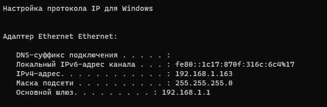{ #fig:001 width=85% }

## MAC-адрес устройства

MAC-адрес компьютера: `00:f8:1c:07:c4:41`.

MAC-адрес шлюза: `c8:7f:54:78:b6:f2`.

Адрес компьютера является индивидуальным и глобально администрируемым.

# Анализ ICMP и ARP

## Проверка доступности шлюза

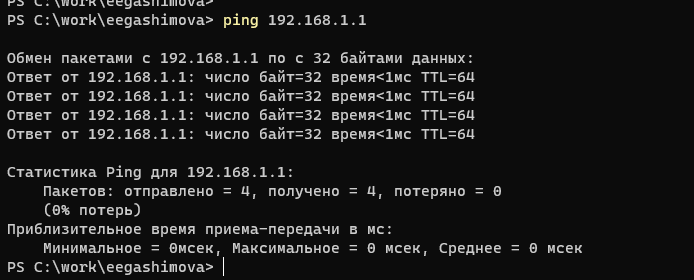{ #fig:002 width=85% }

## ICMP Echo Request

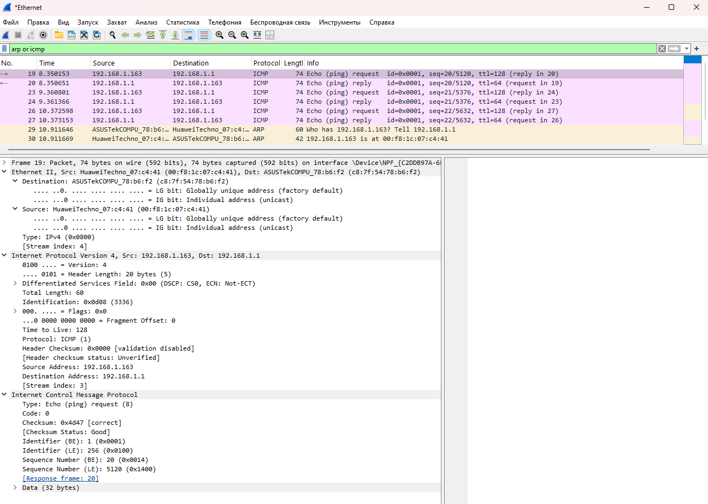{ #fig:003 width=85% }

## ICMP Echo Reply

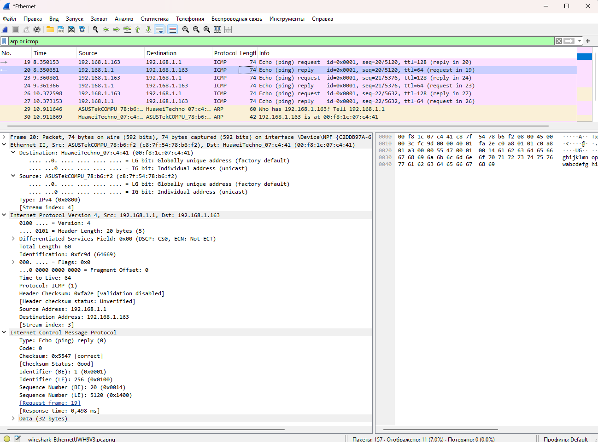{ #fig:004 width=85% }

## ARP-запрос и ARP-ответ

{ #fig:005 width=80% }

## ARP-запрос и ARP-ответ

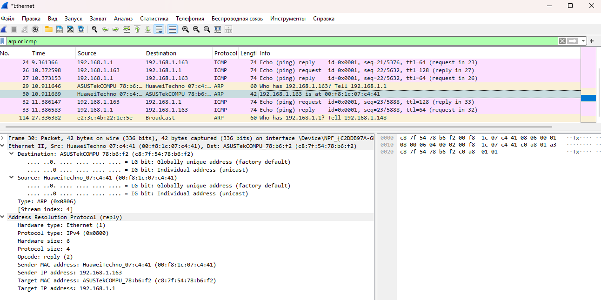{ #fig:006 width=80% }

# Анализ внешнего ICMP-трафика

## Ping внешнего узла

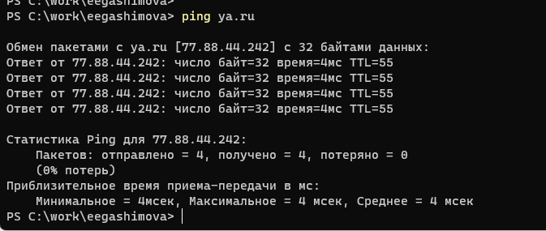{ #fig:007 width=85% }

## ICMP к внешнему адресу

{ #fig:008 width=80% }

## ICMP к внешнему адресу

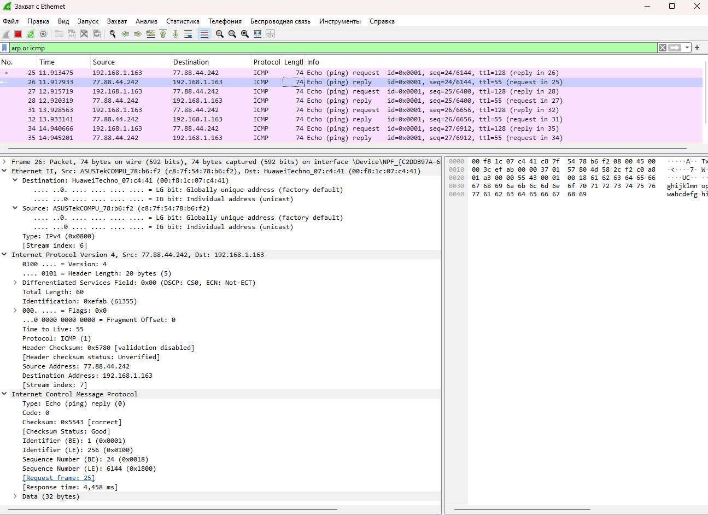{ #fig:009 width=80% }

# Анализ транспортного уровня

## HTTP и TCP

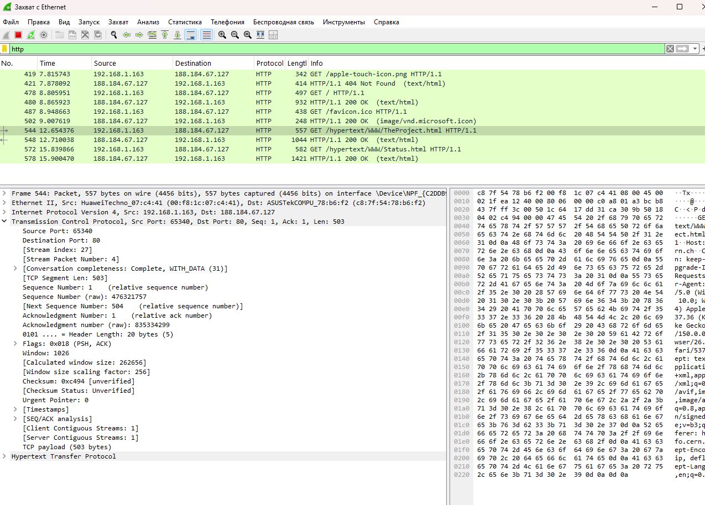{ #fig:011 width=85% }

## HTTP-ответ

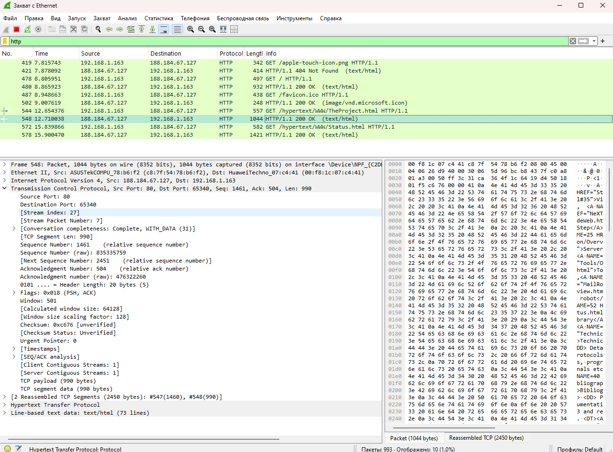{ #fig:012 width=85% }

## DNS и UDP

{ #fig:013 width=85% }

## DNS-ответ

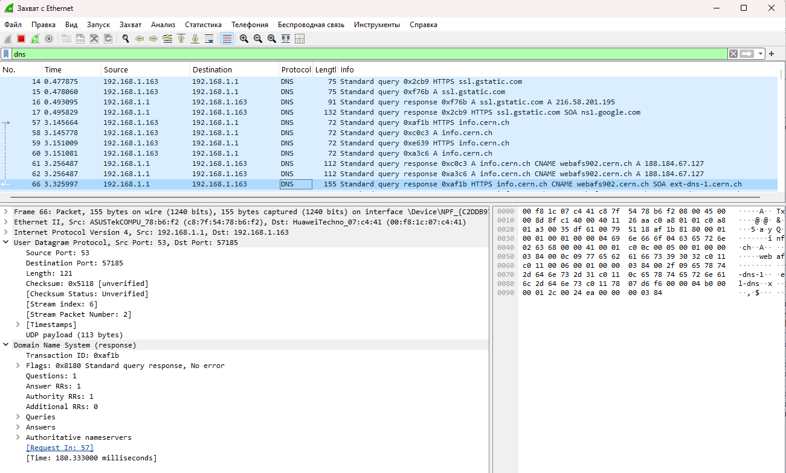{ #fig:014 width=85% }

## QUIC

{ #fig:015 width=85% }

## QUIC

{ #fig:016 width=85% }

# TCP Handshake

## Установление TCP-соединения

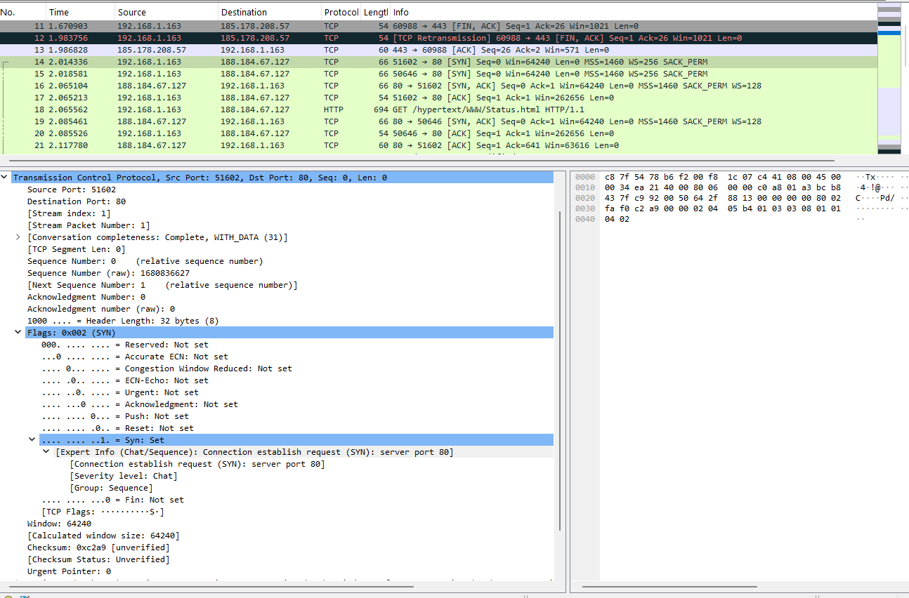{ #fig:017 width=85% }

## График потока TCP

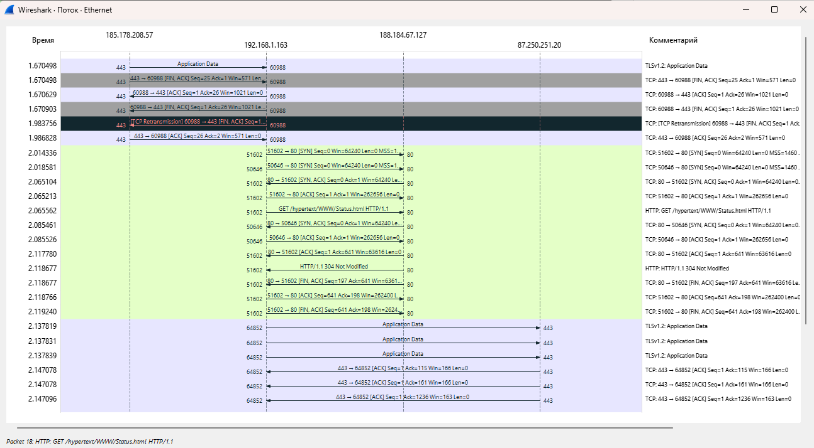{ #fig:018 width=85% }

# Вывод

## Вывод

В ходе работы были изучены MAC-адресация и структура Ethernet-кадров.

С помощью Wireshark были проанализированы протоколы ARP, ICMP, HTTP, DNS, TCP, UDP и QUIC.

Было установлено, что TCP использует трёхэтапное соединение `SYN → SYN/ACK → ACK`, HTTP работает поверх TCP, а DNS и QUIC используют UDP.