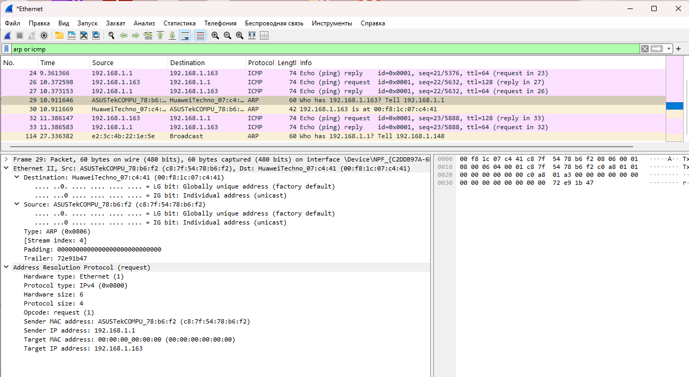
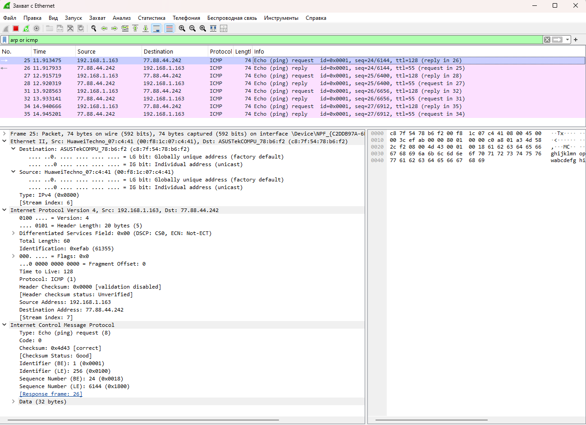
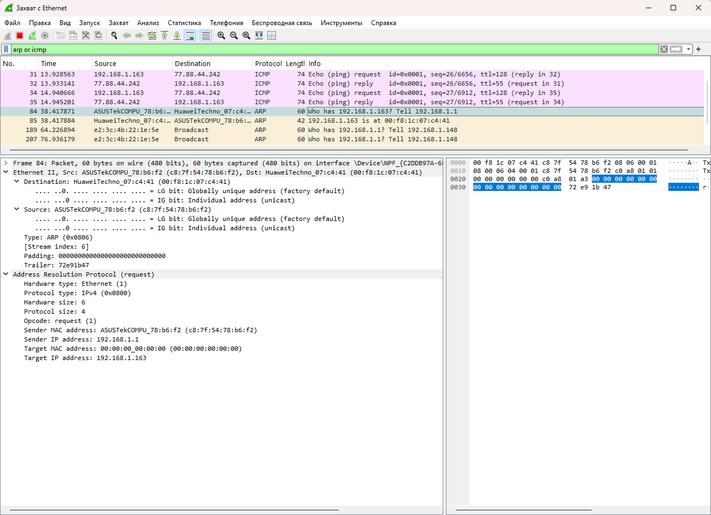
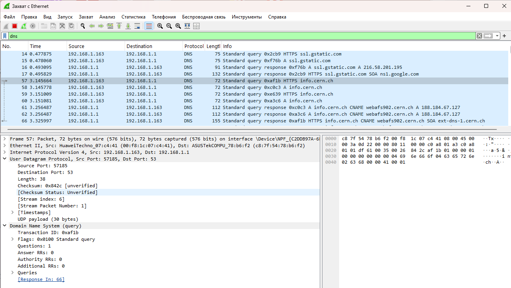
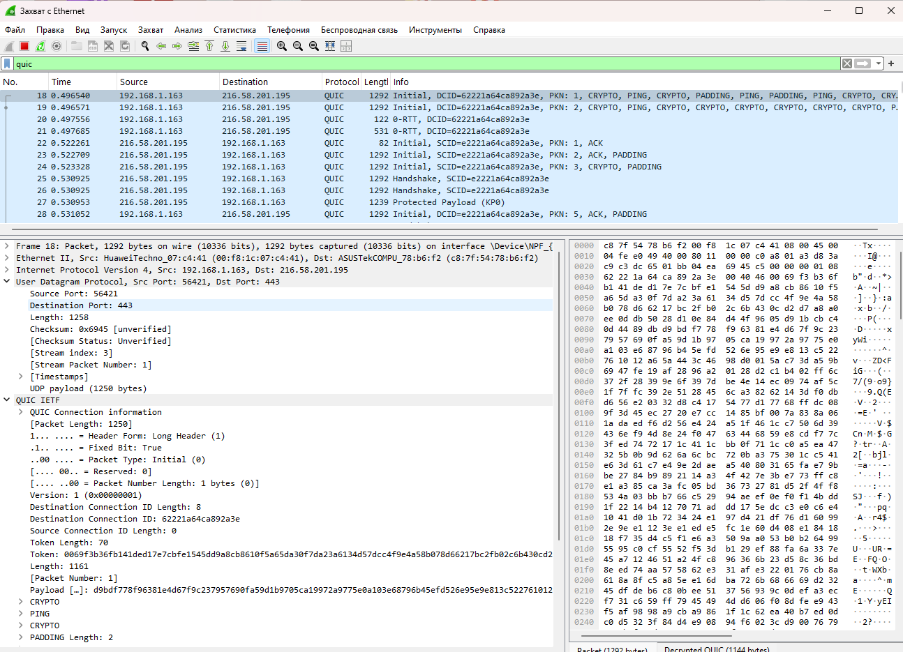
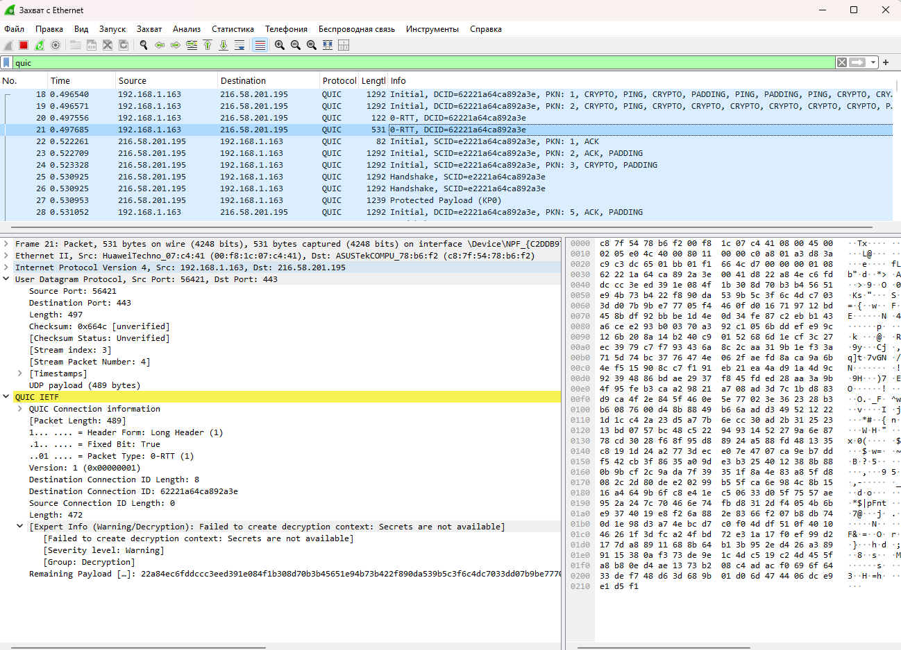

---
## Author
author:
  name: Гашимова Эсма Эльшан кызы
  email: 1132247520@rudn.ru
  affiliation:
    - name: Российский университет дружбы народов
      country: Российская Федерация
      postal-code: 117198
      city: Москва
      address: ул. Миклухо-Маклая, д. 6

## Title
title: "Отчёт по домашнему заданию №3"
subtitle: "Анализ трафика в Wireshark"
license: "CC BY"
---

# Цель работы

Изучение посредством Wireshark кадров Ethernet, анализ PDU протоколов транспортного и прикладного уровней стека TCP/IP.

# Выполнение лабораторной работы

## MAC-адресация

### Определение параметров сетевого подключения

На компьютере под управлением Windows исследую параметры активного сетевого интерфейса с помощью команды `ipconfig`. Без дополнительных параметров команда выводит основные сведения о сетевых интерфейсах: IPv4-адрес, IPv6-адрес, маску подсети и основной шлюз. Для получения расширенной информации команда `ipconfig` поддерживает дополнительные параметры. Опция `/all` позволяет получить полную конфигурацию сетевых адаптеров, включая физический MAC-адрес, состояние DHCP, адреса DNS-серверов и другие сведения; `/displaydns` выводит содержимое локального кэша DNS; `/release` освобождает полученную от DHCP конфигурацию, а `/renew` запрашивает её повторно.

По выводу `ipconfig` определяю параметры активного интерфейса Ethernet. Компьютеру назначен IPv4-адрес `192.168.1.163` с маской подсети `255.255.255.0`, что соответствует префиксу `/24`. Основным шлюзом является узел `192.168.1.1`. Также интерфейсу назначен локальный IPv6-адрес канала `fe80::1c17:870f:316c:6c4%17`. Адрес с префиксом `fe80::/10` предназначен для взаимодействия между узлами непосредственно в пределах одного канала и не маршрутизируется за пределы локального сегмента сети (см. рис. [@fig-001]).

{ #fig-001 width=70% }

### Определение MAC-адреса сетевого интерфейса

При анализе кадров в Wireshark определяю MAC-адрес активного Ethernet-интерфейса компьютера. В заголовках Ethernet II компьютер обозначается как `HuaweiTechno_07:c4:41`, а полный физический адрес интерфейса имеет значение `00:f8:1c:07:c4:41`. MAC-адрес шлюза `192.168.1.1` имеет значение `c8:7f:54:78:b6:f2` и распознаётся Wireshark как устройство ASUSTek.

MAC-адрес Ethernet представляет собой 48-битное значение, состоящее из шести октетов. Для адреса компьютера

`00:f8:1c:07:c4:41`

первые 24 бита, то есть `00:f8:1c`, являются идентификатором организации OUI и определяют производителя сетевого оборудования. Wireshark распознаёт данный префикс как Huawei Technologies. Оставшиеся 24 бита `07:c4:41` идентифицируют конкретный сетевой интерфейс в адресном пространстве производителя.

Тип MAC-адреса определяется по двум младшим битам первого октета. Первый октет адреса компьютера равен `00` в шестнадцатеричной системе или `00000000` в двоичной системе. Младший бит I/G равен `0`, поэтому адрес является индивидуальным, то есть unicast. Следующий бит U/L также равен `0`, поэтому адрес является глобально администрируемым и назначен производителем, а не сформирован локально операционной системой. Wireshark подтверждает это значениями `IG bit: Individual address (unicast)` и `LG bit: Globally unique address (factory default)` (см. рис. [@fig-003]).

## Анализ кадров канального уровня в Wireshark

### Проверка доступности шлюза по умолчанию

На компьютере установлен и запущен анализатор сетевого трафика Wireshark. Для захвата выбираю активный интерфейс Ethernet. Перед анализом трафика проверяю доступность определённого ранее шлюза `192.168.1.1` с помощью команды `ping 192.168.1.1`.

Отправлено четыре ICMP Echo Request и получено четыре ICMP Echo Reply. Потерь пакетов не наблюдается: отправлено `4`, получено `4`, потеряно `0`, то есть потери составляют `0%`. Время ответа составляет менее `1 мс`, TTL полученных пакетов равен `64`. Следовательно, шлюз доступен с компьютера и находится в непосредственно подключённой локальной сети (см. рис. [@fig-002]).

{ #fig-002 width=70% }

### Анализ ICMP Echo Request

После завершения захвата устанавливаю в Wireshark фильтр отображения

`arp or icmp`

В списке остаются кадры протоколов ARP и ICMP, в том числе пакеты, созданные командой `ping`.

В качестве первого ICMP Echo Request анализирую кадр № 19. Его размер составляет `74 байта`, или `592 бита`. Кадр относится к формату `Ethernet II`. В поле EtherType содержится значение `0x0800`, обозначающее передачу пакета IPv4.

MAC-адресом источника является адрес компьютера `00:f8:1c:07:c4:41`, а MAC-адресом получателя — адрес шлюза `c8:7f:54:78:b6:f2`. Оба адреса являются индивидуальными и глобально администрируемыми, что видно по значениям IG и LG в Wireshark.

На сетевом уровне источник имеет IP-адрес `192.168.1.163`, а получатель — `192.168.1.1`. Поле IPv4 `Protocol` имеет значение `ICMP (1)`. В заголовке ICMP указан тип `Echo (ping) request (8)` и код `0`. Номер последовательности пакета равен `20`, объём ICMP-данных составляет `32 байта`. В Wireshark запрос связан с ответным кадром № 20 (см. рис. [@fig-003]).

{ #fig-003 width=70% }

### Анализ ICMP Echo Reply

Далее анализирую кадр № 20, являющийся ответом на предыдущий запрос. Размер кадра также равен `74 байта`, используется формат `Ethernet II`, а EtherType `0x0800` указывает на IPv4.

Направление MAC-адресов относительно запроса изменилось. Источником теперь является шлюз `c8:7f:54:78:b6:f2`, а получателем — интерфейс компьютера `00:f8:1c:07:c4:41`. Оба MAC-адреса по-прежнему являются индивидуальными глобально администрируемыми адресами.

На сетевом уровне исходным адресом является `192.168.1.1`, а адресом назначения — `192.168.1.163`. В ICMP используется тип `Echo (ping) reply (0)` с кодом `0`. Номер последовательности равен `20`, что позволяет сопоставить ответ с соответствующим Echo Request. Wireshark показывает `Request frame: 19`, а время между запросом и ответом составляет приблизительно `0,498 мс` (см. рис. [@fig-004]).

{ #fig-004 width=70% }

### Анализ ARP-запроса

В той же последовательности пакетов присутствует обмен протокола ARP. Анализирую кадр № 29 размером `60 байт`. В заголовке Ethernet II указан тип `ARP (0x0806)`.

Отправителем является шлюз: его MAC-адрес равен `c8:7f:54:78:b6:f2`, а IP-адрес — `192.168.1.1`. Запрашивается аппаратный адрес узла с IP `192.168.1.163`, то есть моего компьютера. В ARP-заголовке поле `Opcode` имеет значение `request (1)`, аппаратный тип — `Ethernet (1)`, тип сетевого протокола — `IPv4 (0x0800)`, размер аппаратного адреса — `6 байт`, а размер адреса протокола — `4 байта`.

Поле `Target MAC address` внутри ARP-запроса заполнено значением `00:00:00:00:00:00`, поскольку запрашивающая сторона определяет физический адрес для IP `192.168.1.163`. При этом сам Ethernet-кадр направлен на MAC `00:f8:1c:07:c4:41`. Это означает, что в данном случае наблюдается unicast ARP-запрос, который может использоваться для проверки или обновления уже известной записи ARP-кэша (см. рис. [@fig-005]).

{ #fig-005 width=70% }

### Анализ ARP-ответа

В кадре № 30 компьютер отправляет ARP Reply шлюзу. Размер захваченного кадра составляет `42 байта`. В заголовке Ethernet II источником является компьютер `00:f8:1c:07:c4:41`, а получателем — шлюз `c8:7f:54:78:b6:f2`.

В ARP-заголовке поле `Opcode` имеет значение `reply (2)`. В ответе явно сообщается соответствие IP- и MAC-адресов: IP `192.168.1.163` соответствует MAC `00:f8:1c:07:c4:41`. Получателем ответа является IP `192.168.1.1` с MAC `c8:7f:54:78:b6:f2`. На основании этого ответа маршрутизатор может создать или обновить запись в своей ARP-таблице (см. рис. [@fig-006]).

{ #fig-006 width=70% }

### Анализ ICMP при обращении к внешнему узлу

Начинаю новый захват и выполняю команду `ping ya.ru`. DNS-разрешение имени возвращает для `ya.ru` адрес `77.88.44.242`. Отправлено четыре запроса и получено четыре ответа, потерь нет. Среднее время ответа составляет приблизительно `4 мс`, а TTL ответов равен `55` (см. рис. [@fig-007]).

{ #fig-007 width=70% }

В Wireshark анализирую первый Echo Request к адресу `77.88.44.242`. Кадр № 25 имеет размер `74 байта`. IP-адресом источника является `192.168.1.163`, а IP-адресом назначения — `77.88.44.242`. При этом на канальном уровне источником остаётся MAC компьютера `00:f8:1c:07:c4:41`, а получателем является не MAC удалённого сервера, а MAC локального шлюза `c8:7f:54:78:b6:f2` (см. рис. [@fig-008]).

{ #fig-008 width=70% }

Данное различие между IP- и MAC-адресацией связано с тем, что MAC-адреса действуют только внутри текущего канального сегмента. Компьютер определяет, что адрес `77.88.44.242` не принадлежит подсети `192.168.1.0/24`, поэтому передаёт Ethernet-кадр шлюзу `192.168.1.1`. IP-пакет при этом по-прежнему содержит адрес конечного удалённого узла.

В ответном кадре № 26 IP-адресом источника является `77.88.44.242`, а назначением — `192.168.1.163`. На канальном уровне источником выступает локальный шлюз `c8:7f:54:78:b6:f2`, а получателем — компьютер `00:f8:1c:07:c4:41`. Размер кадра составляет `74 байта`. Wireshark связывает его с запросом № 25 и показывает время ответа приблизительно `4,458 мс` (см. рис. [@fig-009]).

{ #fig-009 width=70% }

В захвате также присутствуют ARP-пакеты локального сегмента. Например, в кадре № 84 шлюз `192.168.1.1` с MAC `c8:7f:54:78:b6:f2` запрашивает соответствие для IP `192.168.1.163`. В списке дополнительно видны широковещательные ARP-запросы других узлов локальной сети, адресованные `Broadcast`. Это подтверждает, что ARP используется только в пределах локального канального сегмента и не выполняется непосредственно для удалённого адреса `77.88.44.242` (см. рис. [@fig-010]).

{ #fig-010 width=70% }

## Анализ протоколов транспортного уровня в Wireshark

### Анализ HTTP и TCP

Для анализа HTTP-трафика открываю в браузере сайт CERN `http://info.cern.ch/` и устанавливаю в Wireshark фильтр

`http`

В списке пакетов присутствуют HTTP-запросы клиента `192.168.1.163` к серверу `188.184.67.127` и ответы сервера. Видны запросы `GET /`, `GET /favicon.ico`, `GET /hypertext/WWW/TheProject.html`, `GET /hypertext/WWW/Status.html`, а также ответы `HTTP/1.1 200 OK`, `HTTP/1.1 404 Not Found` и другие.

В кадре № 544 компьютер отправляет запрос

`GET /hypertext/WWW/TheProject.html HTTP/1.1`

на сервер `188.184.67.127`. Размер кадра составляет `557 байт`. HTTP передаётся поверх TCP. Клиент использует временный исходный TCP-порт `65340`, а сервер — стандартный HTTP-порт `80`. В сегменте установлены флаги `PSH, ACK`, относительный номер последовательности равен `1`, номер подтверждения — `1`, длина TCP-полезной нагрузки составляет `503 байта`. Флаг ACK означает подтверждение ранее установившегося соединения, а PSH указывает на необходимость передать содержащиеся данные приложению без излишней задержки (см. рис. [@fig-011]).

{ #fig-011 width=70% }

Ответ сервера виден, например, в кадре № 548. Сервер `188.184.67.127` передаёт данные с TCP-порта `80` на клиентский порт `65340`. Размер кадра равен `1044 байта`, длина TCP-полезной нагрузки составляет `990 байт`. Установлены флаги `PSH, ACK`, относительный Sequence Number равен `1461`, а Acknowledgment Number — `504`.

На прикладном уровне Wireshark определяет ответ `HTTP/1.1 200 OK` с содержимым типа `text/html`. Также видно, что HTTP-данные могут быть разбиты на несколько TCP-сегментов, после чего Wireshark выполняет их повторную сборку. В данном случае отображается `Reassembled TCP Segments`, а затем восстановленный HTTP-документ (см. рис. [@fig-012]).

{ #fig-012 width=70% }

### Анализ DNS и UDP

Далее применяю фильтр

`dns`

Перед установлением HTTP-соединения компьютер должен определить IP-адрес имени `info.cern.ch`. В списке пакетов видны DNS-запросы типов `A` и `HTTPS`, направленные с адреса `192.168.1.163` на DNS-сервер `192.168.1.1`.

В кадре № 57 анализируется DNS-запрос типа `HTTPS` для имени `info.cern.ch`. DNS в данном случае передаётся поверх UDP. Клиент использует исходный порт `57185`, а порт назначения равен стандартному DNS-порту `53`. Длина UDP-дейтаграммы составляет `38 байт`, из которых `30 байт` приходится на полезную нагрузку. DNS Transaction ID имеет значение `0xaf1b`. В запросе установлен флаг `Standard query`, содержится один вопрос и отсутствуют записи Answer, Authority и Additional (см. рис. [@fig-013]).

{ #fig-013 width=70% }

В ответном кадре № 66 направление передачи меняется. DNS-сервер `192.168.1.1` отправляет пакет с исходного UDP-порта `53` на клиентский порт `57185`. Длина UDP-дейтаграммы составляет `121 байт`, а полезной нагрузки — `113 байт`. Transaction ID остаётся `0xaf1b`, благодаря чему клиент и Wireshark могут сопоставить ответ с запросом № 57. В заголовке DNS установлен признак `Standard query response, No error`.

В списке пакетов также видны запросы типа `A` для `info.cern.ch`. В ответах DNS имя `info.cern.ch` связано через CNAME с `webafs902.cern.ch`, которому соответствует IPv4-адрес `188.184.67.127`. Именно этот адрес затем используется компьютером для установления HTTP-соединения с сервером CERN (см. рис. [@fig-014]).

{ #fig-014 width=70% }

### Анализ QUIC

Для исследования трафика QUIC применяю фильтр

`quic`

В захвате присутствует обмен между компьютером `192.168.1.163` и удалённым сервером `216.58.201.195`. В отличие от HTTP поверх TCP, QUIC работает поверх UDP и реализует собственные механизмы установления соединения, надёжной доставки, управления потоками и криптографической защиты.

В кадре № 18 компьютер отправляет QUIC Initial на адрес `216.58.201.195`. Размер всего кадра равен `1292 байта`. На транспортном уровне используется UDP: исходный порт клиента `56421`, порт назначения `443`, длина UDP-дейтаграммы составляет `1258 байт`, а полезная нагрузка UDP — `1250 байт`.

В заголовке QUIC используется Long Header, Packet Type имеет значение `Initial (0)`, версия протокола — `1`. Destination Connection ID равен `62221a64ca892a3e`. Номер пакета равен `1`. В составе QUIC Initial Wireshark отображает фреймы `CRYPTO`, `PING` и `PADDING`. Поля CRYPTO содержат данные, необходимые для криптографического согласования параметров соединения, а PADDING используется в том числе для доведения Initial-пакета до требуемого минимального размера (см. рис. [@fig-015]).

{ #fig-015 width=70% }

В дальнейшем в захвате видны пакеты `0-RTT`, `Initial`, `Handshake` и `Protected Payload`. Например, кадр № 21 также передаётся от `192.168.1.163` к `216.58.201.195` через UDP-порты `56421 → 443`, имеет размер `531 байт`, а QUIC-пакет имеет тип `0-RTT`.

Механизм 0-RTT позволяет клиенту при наличии ранее полученной криптографической информации передавать прикладные данные ещё до полного завершения нового handshake. После этого сервер отправляет Initial и Handshake-пакеты, а дальнейшие данные передаются в зашифрованном виде. В Wireshark присутствует сообщение `Failed to create decryption context: Secrets are not available`, следовательно, без соответствующих ключей содержимое части зашифрованного QUIC-трафика расшифровать невозможно (см. рис. [@fig-016]).

{ #fig-016 width=70% }

## Анализ handshake протокола TCP в Wireshark

### Трёхэтапное установление TCP-соединения

Для анализа TCP handshake использую соединение с HTTP-сервером CERN `188.184.67.127` на порту `80`. В захвате Wireshark отчётливо видна последовательность SYN, SYN/ACK и ACK.

Первым этапом является кадр № 14. Компьютер `192.168.1.163` инициирует соединение с `188.184.67.127` и отправляет сегмент

`51602 → 80 [SYN] Seq=0 Win=64240 Len=0`

Клиент использует временный порт `51602`, сервер — порт `80`. Флаг SYN установлен, Sequence Number в относительном представлении Wireshark равен `0`, Acknowledgment Number также равен `0`, поскольку клиент ещё не подтверждает данные сервера. Длина полезной нагрузки равна `0`. В параметрах SYN передаются `MSS=1460`, `WS=256` и разрешение `SACK_PERM`.

На втором этапе сервер отвечает кадром № 16:

`80 → 51602 [SYN, ACK] Seq=0 Ack=1 Win=64240 Len=0`

Сервер одновременно устанавливает собственный SYN и подтверждает SYN клиента. Значение `Ack=1` связано с тем, что флаг SYN занимает одну позицию в пространстве номеров последовательности. Сервер также передаёт свои TCP-параметры, в частности `MSS=1460`, `SACK_PERM` и масштаб окна `WS=128`.

На третьем этапе компьютер отправляет кадр № 17:

`51602 → 80 [ACK] Seq=1 Ack=1 Win=262656 Len=0`

SYN уже не установлен, используется только ACK. Клиент подтверждает SYN сервера значением `Ack=1`. После этой операции TCP-соединение считается установленным и может использоваться для передачи прикладных данных. Следующим кадром в этом потоке уже передаётся HTTP-запрос `GET /hypertext/WWW/Status.html HTTP/1.1`.

Одновременно браузер устанавливает ещё одно параллельное TCP-соединение с портом клиента `50646`. Для него аналогичная последовательность представлена кадрами № 15, 19 и 20. Создание нескольких TCP-соединений позволяет браузеру параллельно получать различные ресурсы HTTP (см. рис. [@fig-017]).

{ #fig-017 width=70% }

### Анализ графика потока TCP

В меню Wireshark `Статистика → График потока` открываю графическое представление обмена пакетами. На диаграмме каждому сетевому узлу соответствует отдельная вертикальная линия, а стрелками показано направление сегментов между ними.

Для соединения `192.168.1.163:51602 → 188.184.67.127:80` сначала отображается SYN от клиента к серверу. В обратном направлении следует SYN/ACK, после чего клиент передаёт ACK. Данная последовательность полностью соответствует трёхэтапному механизму TCP handshake.

После установки соединения на графике появляется HTTP-запрос `GET /hypertext/WWW/Status.html HTTP/1.1`. Сервер подтверждает полученные TCP-данные и передаёт HTTP-ответ `HTTP/1.1 304 Not Modified`. Далее на графике виден обмен сегментами с флагами `FIN, ACK`, используемыми для корректного завершения TCP-соединения.

На графике также отображается второе HTTP-соединение с исходным портом `50646`, а кроме него — другие сетевые потоки, в частности соединения с портом `443`. Они относятся к параллельному сетевому трафику компьютера и не изменяют рассматриваемую последовательность установки HTTP-соединения с сервером CERN (см. рис. [@fig-018]).

{ #fig-018 width=70% }

# Вывод

В ходе лабораторной работы исследованы принципы MAC-адресации и структура Ethernet-кадров. Для активного интерфейса компьютера определён MAC-адрес `00:f8:1c:07:c4:41`, являющийся индивидуальным и глобально администрируемым. MAC-адрес шлюза равен `c8:7f:54:78:b6:f2`. На примере ICMP установлено, что при взаимодействии с узлом локальной сети Ethernet-кадр передаётся непосредственно его MAC-адресу, а при взаимодействии с удалённым узлом в качестве MAC-адреса назначения используется адрес шлюза по умолчанию.

С помощью Wireshark исследована работа ARP, ICMP, HTTP, DNS, TCP, UDP и QUIC. ARP обеспечивает установление соответствия между IPv4- и MAC-адресами внутри локального сегмента, ICMP используется для проверки сетевой доступности, HTTP в рассмотренном случае работает поверх TCP, а DNS и QUIC используют UDP. Для TCP исследован трёхэтапный handshake `SYN → SYN/ACK → ACK` и изменение номеров Sequence и Acknowledgment при установлении соединения. График потока Wireshark позволил наглядно проследить установление TCP-соединения, передачу HTTP-данных и последующее завершение соединения.