---
## Author
author:
  name: Гашимова Эсма Эльшан кызы
  email: 1132247520@rudn.ru
  affiliation:
    - name: Российский университет дружбы народов
      country: Российская Федерация
      postal-code: 117198
      city: Москва
      address: ул. Миклухо-Маклая, д. 6

## Title
title: Лабораторная работа №4
subtitle: Адресация IPv4 и IPv6. Двойной стек
license: CC BY
date: today
date-format: "YYYY-MM-DD"
---

# Цели и задачи работы

## Цель лабораторной работы

Изучение принципов настройки IPv4- и IPv6-адресации в локальных сетях.

Получение навыков настройки двойного стека адресации.

Проверка сетевой связности между устройствами с помощью `ping` и `trace`.

Анализ трафика ARP, ICMP и ICMPv6 в Wireshark.

# Настройка сети с двойным стеком

## Создание топологии

{ #fig:001 width=85% height=70% }

## Настройка PC1

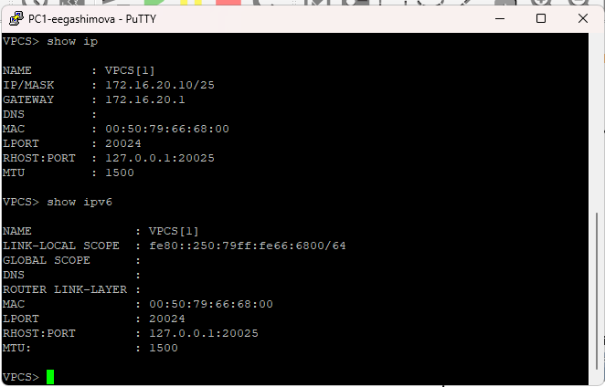{ #fig:002 width=70% height=65% }

## Настройка PC2

{ #fig:003 width=70% height=65% }

## Настройка сервера IPv4

{ #fig:004 width=70% height=65% }

# Настройка маршрутизатора FRR

## Настройка IPv4-интерфейсов FRR

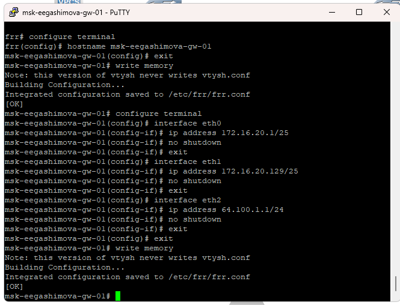{ #fig:005 width=75% height=65% }

## Проверка конфигурации FRR

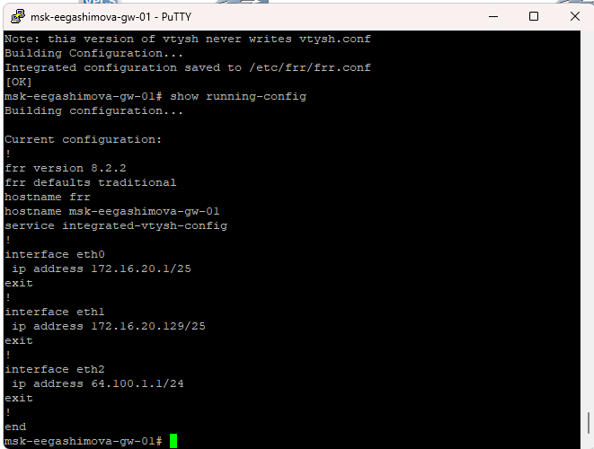{ #fig:006 width=70% height=65% }

## Проверка интерфейсов FRR

{ #fig:007 width=70% height=65% }

# Проверка IPv4-связности

## Проверка связи с PC1

{ #fig:008 width=75% height=65% }

## Проверка связи с PC2

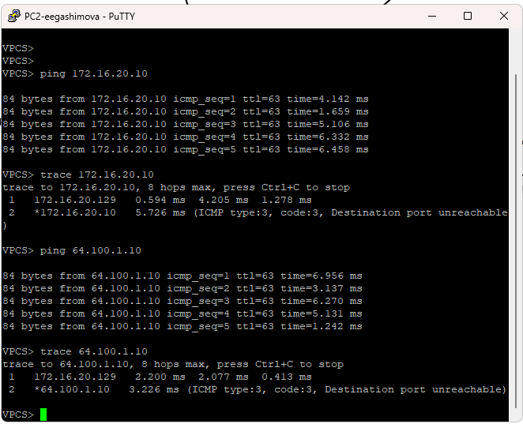{ #fig:009 width=75% height=65% }

# Настройка IPv6-сети

## Настройка PC3

{ #fig:010 width=70% height=65% }

## Настройка PC4

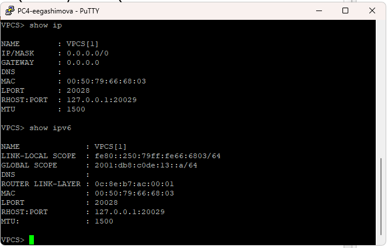{ #fig:011 width=70% height=65% }

# Настройка маршрутизатора VyOS

## Начальная настройка VyOS

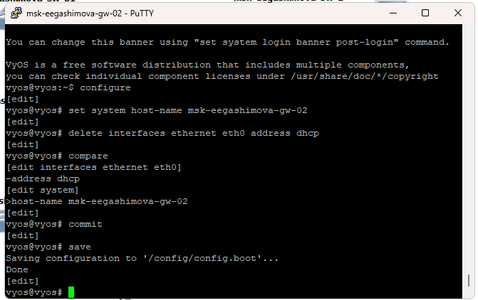{ #fig:012 width=75% height=65% }

## Настройка IPv6-интерфейсов VyOS

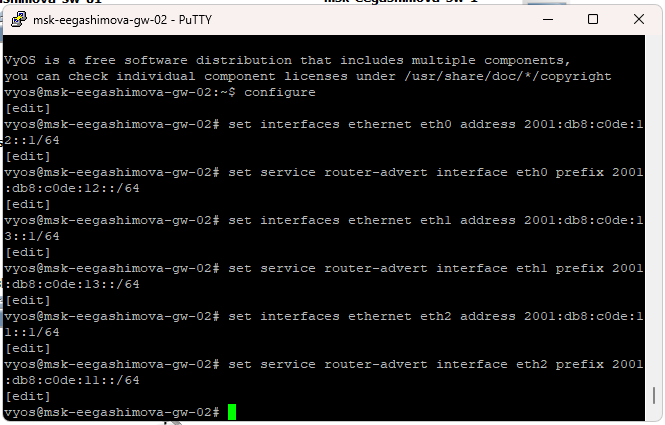{ #fig:013 width=75% height=65% }

## Проверка интерфейсов VyOS

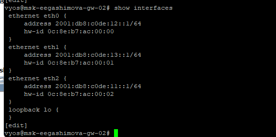{ #fig:014 width=70% height=65% }

# Проверка IPv6-связности

## Проверка связи с PC3

{ #fig:015 width=75% height=65% }

## Проверка связи с PC4

{ #fig:016 width=75% height=65% }

## Проверка сервера двойного стека

{ #fig:017 width=75% height=65% }

# Анализ трафика в Wireshark

## Анализ ARP

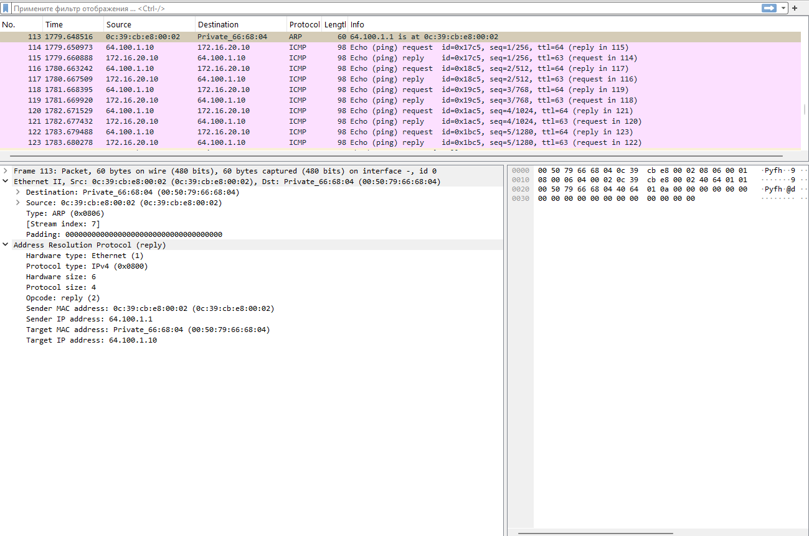{ #fig:018 width=90% height=65% }

## Анализ ICMP

{ #fig:019 width=90% height=65% }

## Анализ ICMPv6

{ #fig:020 width=90% height=65% }

# Самостоятельное задание

## Исходные подсети

Для самостоятельного задания заданы две подсети:

`10.10.1.96/27`

`2001:db8:1:1::/64`

и

`10.10.1.16/28`

`2001:db8:1:4::/64`

Для интерфейсов маршрутизатора выбраны минимальные доступные адреса подсетей.

## Таблица адресации

Для первой подсети выбран шлюз:

`10.10.1.97/27`

`2001:db8:1:1::1/64`

Для второй подсети выбран шлюз:

`10.10.1.17/28`

`2001:db8:1:4::1/64`

Оконечные устройства получают адреса из соответствующих подсетей.

## Топология самостоятельного задания

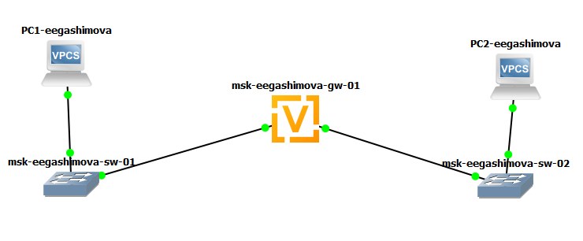{ #fig:021 width=80% height=65% }

## Настройка PC1

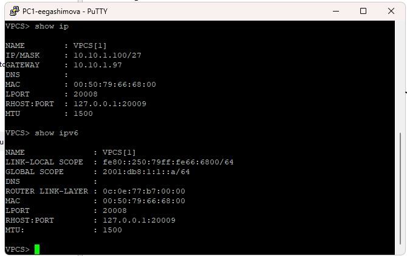{ #fig:022 width=70% height=65% }

## Настройка PC2

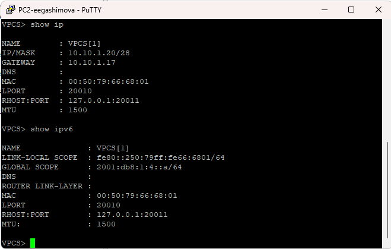{ #fig:023 width=70% height=65% }

## Начальная настройка маршрутизатора

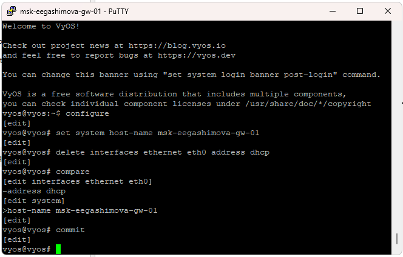{ #fig:024 width=75% height=65% }

## Настройка интерфейсов маршрутизатора

{ #fig:025 width=75% height=65% }

## Проверка интерфейсов

{ #fig:026 width=70% height=65% }

# Проверка самостоятельного задания

## Проверка связи с PC1

{ #fig:027 width=75% height=65% }

## Проверка связи с PC2

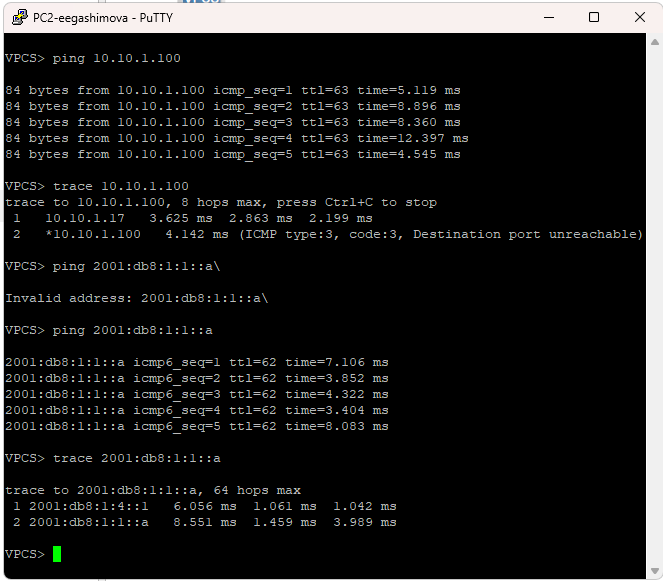{ #fig:028 width=75% height=65% }

# Результаты работы

## Выполненные действия

В GNS3 построена топология сети с IPv4- и IPv6-подсетями.

Настроены маршрутизаторы FRR и VyOS.

Настроены оконечные устройства VPCS.

Проверена связность между узлами с помощью `ping` и `trace`.

Проанализирован трафик ARP, ICMP и ICMPv6 в Wireshark.

## Полученные результаты

IPv4-сеть работает через маршрутизатор FRR.

IPv6-сеть работает через маршрутизатор VyOS.

Сервер двойного стека доступен как по IPv4, так и по IPv6.

Устройства только с IPv4 и только с IPv6 напрямую друг другу недоступны.

Самостоятельная топология успешно настроена с двойным стеком адресации.

## Вывод

В ходе лабораторной работы была настроена сеть с поддержкой IPv4 и IPv6.

Были получены практические навыки настройки адресации на VPCS, FRR и VyOS.

Анализ трафика показал различия между ARP в IPv4 и Neighbor Discovery в IPv6.

Работоспособность созданных топологий подтверждена успешными проверками `ping` и `trace`.