---
## Author
author:
  name: Гашимова Эсма Эльшан кызы
  email: 1132247520@rudn.ru
  affiliation:
    - name: Российский университет дружбы народов
      country: Российская Федерация
      postal-code: 117198
      city: Москва
      address: ул. Миклухо-Маклая, д. 6

## Title
title: "Отчёт по лабораторной работе №4"
subtitle: "Адресация IPv4 и IPv6. Двойной стек"
license: "CC BY"
---

# Цель работы

Изучение принципов распределения и настройки адресного пространства на устройствах сети

# Выполнение лабораторной работы

## Настройка двойного стека адресации IPv4 и IPv6 в локальной сети

### Построение топологии сети

Создаю новый проект в GNS3 и размещаю устройства в соответствии с заданной топологией. Для части сети, использующей IPv4, применяю маршрутизатор FRR, для части сети с IPv6 — маршрутизатор VyOS. В качестве оконечных устройств использую VPCS. Между узлами и маршрутизаторами устанавливаю Ethernet-коммутаторы.

Изменяю отображаемые имена устройств с использованием имени учётной записи `eegashimova`. Маршрутизаторам присваиваю имена `msk-eegashimova-gw-01` и `msk-eegashimova-gw-02`, оконечным устройствам — `PC1-eegashimova`, `PC2-eegashimova`, `PC3-eegashimova`, `PC4-eegashimova` и `Server-eegashimova`. Коммутаторы также именую в соответствии с принятой схемой `msk-eegashimova-sw-*`.

Сервер располагаю в общей сети между маршрутизаторами. Он должен одновременно иметь IPv4- и IPv6-адрес и выполнять роль узла с двойным стеком. На соединении сервера с ближайшим коммутатором включаю захват трафика для последующего анализа ARP, ICMP и ICMPv6 (см. рис. [@fig-001]).

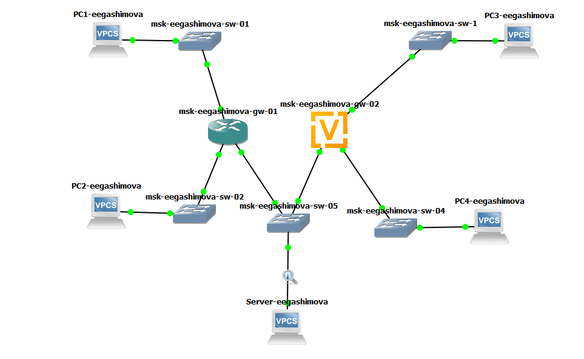{ #fig-001 width=85% }

### Настройка оконечных устройств IPv4

На узле `PC1-eegashimova` назначаю IPv4-адрес `172.16.20.10/25` и шлюз по умолчанию `172.16.20.1`, после чего сохраняю конфигурацию:

```text
ip 172.16.20.10/25 172.16.20.1
save
```

Проверяю полученную конфигурацию командами:

```text
show ip
show ipv6
```

Команда `show ip` показывает адрес `172.16.20.10/25` и шлюз `172.16.20.1`. Глобальный IPv6-адрес на этом узле не настроен, однако VPCS автоматически использует локальный адрес канала `fe80::250:79ff:fe66:6800/64` (см. рис. [@fig-002]).

{ #fig-002 width=70% }

Аналогично настраиваю `PC2-eegashimova`. Ему назначаю адрес `172.16.20.138/25`, принадлежащий другой IPv4-подсети, и шлюз `172.16.20.129`:

```text
ip 172.16.20.138/25 172.16.20.129
save
show ip
show ipv6
```

В результате на PC2 используется IPv4-адрес `172.16.20.138/25`. Глобальный IPv6-адрес отсутствует, присутствует только автоматически сформированный link-local адрес `fe80::250:79ff:fe66:6801/64` (см. рис. [@fig-003]).

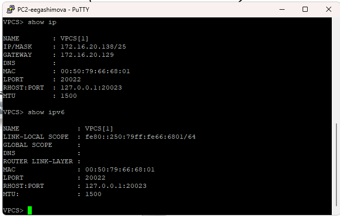{ #fig-003 width=70% }

На сервере двойного стека сначала настраиваю IPv4-часть. Назначаю адрес `64.100.1.10/24` и указываю маршрутизатор FRR `64.100.1.1` в качестве шлюза по умолчанию:

```text
ip 64.100.1.10/24 64.100.1.1
save
show ip
show ipv6
```

На данном этапе сервер имеет IPv4-адрес `64.100.1.10/24`. В IPv6 присутствует только локальный адрес канала `fe80::250:79ff:fe66:6804/64`; глобальный IPv6-адрес будет настроен позднее (см. рис. [@fig-004]).

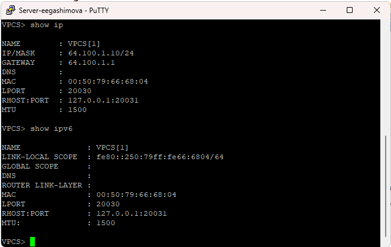{ #fig-004 width=70% }

### Настройка IPv4 на маршрутизаторе FRR

Перехожу в консоль маршрутизатора FRR. Сначала изменяю его hostname на `msk-eegashimova-gw-01` и сохраняю конфигурацию:

```text
configure terminal
hostname msk-eegashimova-gw-01
exit
write memory
```

После этого назначаю IPv4-адреса трём интерфейсам маршрутизатора. Интерфейс `eth0` обслуживает подсеть PC1, `eth1` — подсеть PC2, а `eth2` соединяет маршрутизатор с сетью сервера:

```text
configure terminal

interface eth0
 ip address 172.16.20.1/25
 no shutdown
 exit

interface eth1
 ip address 172.16.20.129/25
 no shutdown
 exit

interface eth2
 ip address 64.100.1.1/24
 no shutdown
 exit

exit
write memory
```

FRR сохраняет интегрированную конфигурацию в `/etc/frr/frr.conf`. В результате маршрутизатор получает адреса `172.16.20.1/25`, `172.16.20.129/25` и `64.100.1.1/24` (см. рис. [@fig-005]).

{ #fig-005 width=75% }

Проверяю сохранённую конфигурацию:

```text
show running-config
```

В выводе присутствуют настроенные интерфейсы `eth0`, `eth1` и `eth2` с назначенными им IPv4-адресами, а также установленное имя `msk-eegashimova-gw-01` (см. рис. [@fig-006]).

{ #fig-006 width=70% }

Дополнительно проверяю состояние интерфейсов:

```text
show interface brief
```

Интерфейсы `eth0`, `eth1` и `eth2` находятся в состоянии `up`. Для них отображаются соответственно адреса `172.16.20.1/25`, `172.16.20.129/25` и `64.100.1.1/24`. Неиспользуемые Ethernet-интерфейсы находятся в состоянии `down` (см. рис. [@fig-007]).

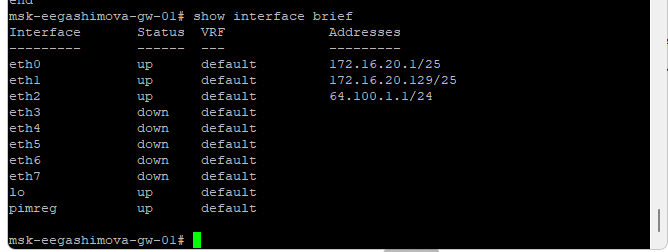{ #fig-007 width=70% }

### Проверка подключения в IPv4-сети

С узла `PC1-eegashimova` проверяю доступность `PC2-eegashimova`:

```text
ping 172.16.20.138
trace 172.16.20.138
```

Все ICMP Echo Request получают ответы. Поскольку PC1 и PC2 находятся в разных `/25` подсетях, трафик проходит через маршрутизатор `msk-eegashimova-gw-01`. В выводе `trace` первым переходом является шлюз `172.16.20.1`, после чего достигается `172.16.20.138`.

Затем проверяю связь с сервером:

```text
ping 64.100.1.10
trace 64.100.1.10
```

Сервер также успешно отвечает. В трассировке сначала отображается `172.16.20.1`, затем конечный узел `64.100.1.10` (см. рис. [@fig-008]).

Сообщение `Destination port unreachable` на конечном узле в выводе `trace` не свидетельствует об отсутствии связи. VPCS использует при трассировке UDP-пакеты, а достигнутый узел сообщает ICMP-сообщением о недоступности конечного UDP-порта, что фактически подтверждает достижение адресата.

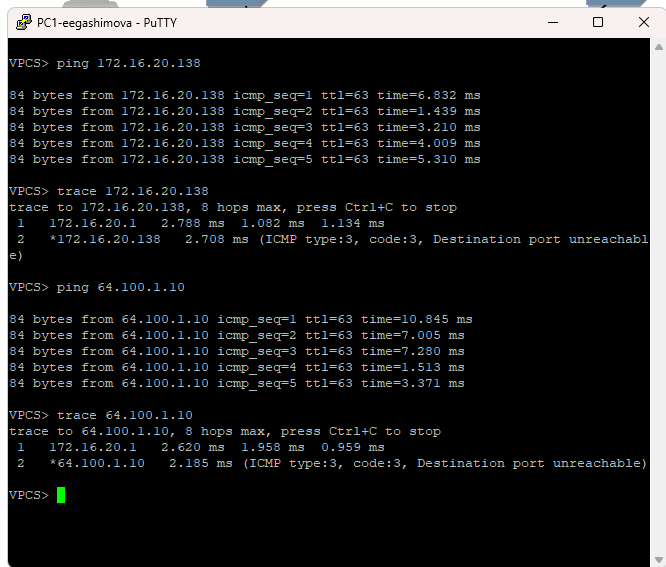{ #fig-008 width=75% }

Провожу аналогичную проверку с `PC2-eegashimova`:

```text
ping 172.16.20.10
trace 172.16.20.10

ping 64.100.1.10
trace 64.100.1.10
```

PC1 и сервер отвечают на все отправленные запросы. При обращении к PC1 первым маршрутизатором является `172.16.20.129`, после чего пакет поступает в подсеть `172.16.20.0/25`. При обращении к серверу трафик через тот же шлюз направляется в сеть `64.100.1.0/24` (см. рис. [@fig-009]).

{ #fig-009 width=75% }

Полученные результаты подтверждают корректность IPv4-адресации и маршрутизации между тремя IPv4-подсетями.

### Настройка оконечных устройств IPv6

Для узла `PC3-eegashimova` настраиваю глобальный IPv6-адрес:

```text
ip 2001:db8:c0de:12::a/64
save
```

После этого выполняю:

```text
show ip
show ipv6
```

IPv4 на PC3 не настроен, поэтому команда `show ip` отображает `0.0.0.0/0`. В IPv6-конфигурации присутствуют глобальный адрес `2001:db8:c0de:12::a/64` и локальный адрес канала `fe80::250:79ff:fe66:6802/64` (см. рис. [@fig-010]).

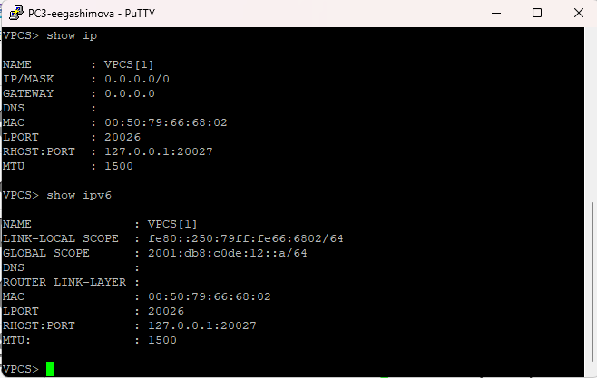{ #fig-010 width=70% }

На `PC4-eegashimova` назначаю адрес другой IPv6-подсети:

```text
ip 2001:db8:c0de:13::a/64
save
show ip
show ipv6
```

Устройство получает глобальный адрес `2001:db8:c0de:13::a/64`. IPv4-адрес отсутствует. В выводе также присутствует link-local адрес `fe80::250:79ff:fe66:6803/64` и информация о канальном адресе IPv6-маршрутизатора, полученная от VyOS (см. рис. [@fig-011]).

{ #fig-011 width=70% }

На сервере двойного стека дополнительно назначаю IPv6-адрес:

```text
ip 2001:db8:c0de:11::a/64
save
```

После этой операции `Server-eegashimova` одновременно использует IPv4-адрес `64.100.1.10/24` и IPv6-адрес `2001:db8:c0de:11::a/64`.

### Настройка маршрутизатора VyOS

Перехожу в консоль маршрутизатора VyOS. В режиме конфигурирования изменяю hostname на `msk-eegashimova-gw-02` и удаляю получение IPv4-адреса по DHCP с интерфейса `eth0`:

```text
configure
set system host-name msk-eegashimova-gw-02
delete interfaces ethernet eth0 address dhcp
compare
commit
save
exit
reboot
```

Команда `compare` показывает удаление параметра `address dhcp` и изменение имени системы. После `commit` новая конфигурация применяется, а `save` сохраняет её в `/config/config.boot` (см. рис. [@fig-012]).

{ #fig-012 width=75% }

После перезапуска маршрутизатора снова перехожу в режим конфигурирования и назначаю IPv6-адреса его интерфейсам:

```text
configure

set interfaces ethernet eth0 address 2001:db8:c0de:12::1/64
set service router-advert interface eth0 prefix 2001:db8:c0de:12::/64

set interfaces ethernet eth1 address 2001:db8:c0de:13::1/64
set service router-advert interface eth1 prefix 2001:db8:c0de:13::/64

set interfaces ethernet eth2 address 2001:db8:c0de:11::1/64
set service router-advert interface eth2 prefix 2001:db8:c0de:11::/64

compare
commit
save
```

Для каждого интерфейса дополнительно настраиваю Router Advertisement соответствующего `/64`-префикса. Это позволяет оконечным узлам обнаруживать IPv6-маршрутизатор и использовать его в качестве маршрутизатора по умолчанию (см. рис. [@fig-013]).

{ #fig-013 width=75% }

Проверяю конфигурацию интерфейсов:

```text
show interfaces
```

Получаю следующие адреса:

- `eth0` — `2001:db8:c0de:12::1/64`;
- `eth1` — `2001:db8:c0de:13::1/64`;
- `eth2` — `2001:db8:c0de:11::1/64`.

Все требуемые IPv6-сети непосредственно подключены к маршрутизатору (см. рис. [@fig-014]).

{ #fig-014 width=70% }

### Проверка подключения в IPv6-сети

С `PC3-eegashimova` проверяю доступность PC4:

```text
ping 2001:db8:c0de:13::a
trace 2001:db8:c0de:13::a
```

Получаю ответы на все ICMPv6 Echo Request. Трассировка показывает промежуточный маршрутизатор `2001:db8:c0de:12::1`, после которого достигается PC4 с адресом `2001:db8:c0de:13::a`.

После этого проверяю сервер двойного стека:

```text
ping 2001:db8:c0de:11::a
trace 2001:db8:c0de:11::a
```

Связь также успешно устанавливается. В конце выполняю попытку обращения к IPv4-адресу сервера:

```text
ping 64.100.1.10
```

VPCS сообщает `host (64.100.1.10) not reachable`, поскольку PC3 не имеет настроенного IPv4-адреса и не может непосредственно использовать IPv4-сеть (см. рис. [@fig-015]).

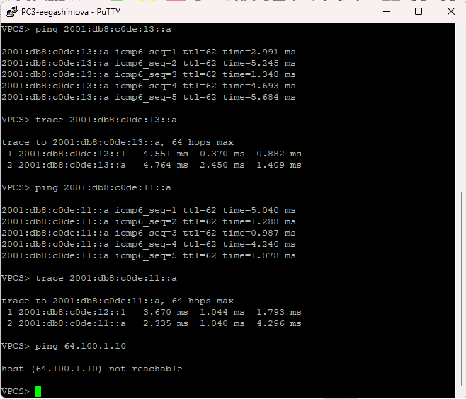{ #fig-015 width=75% }

На `PC4-eegashimova` выполняю аналогичную проверку:

```text
ping 2001:db8:c0de:12::a
trace 2001:db8:c0de:12::a

ping 2001:db8:c0de:11::a
trace 2001:db8:c0de:11::a
```

PC3 и сервер доступны по IPv6. Трассировка проходит через интерфейс маршрутизатора `2001:db8:c0de:13::1`.

Дополнительно пробую обратиться к IPv4-адресу `PC2-eegashimova`:

```text
ping 172.16.20.138
```

Получаю сообщение `host (172.16.20.138) not reachable`, что подтверждает отсутствие прямого взаимодействия IPv6-узла с IPv4-узлом без механизма преобразования между протоколами (см. рис. [@fig-016]).

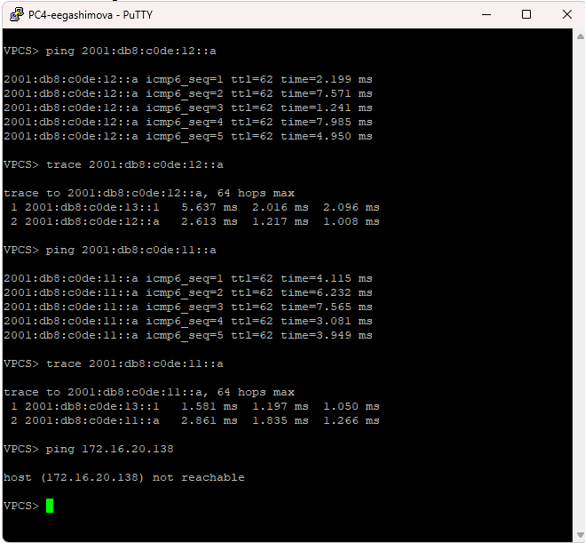{ #fig-016 width=75% }

### Проверка работы сервера двойного стека

Проверяю, что сервер может работать одновременно с обеими группами устройств. С `Server-eegashimova` выполняю:

```text
ping 172.16.20.10
ping 2001:db8:c0de:12::a
ping 172.16.20.138
ping 2001:db8:c0de:13::a
```

Сервер успешно получает ответы от PC1 и PC2 по IPv4, а также от PC3 и PC4 по IPv6. Следовательно, наличие на сервере обоих протоколов позволяет ему взаимодействовать с обеими частями сети (см. рис. [@fig-017]).

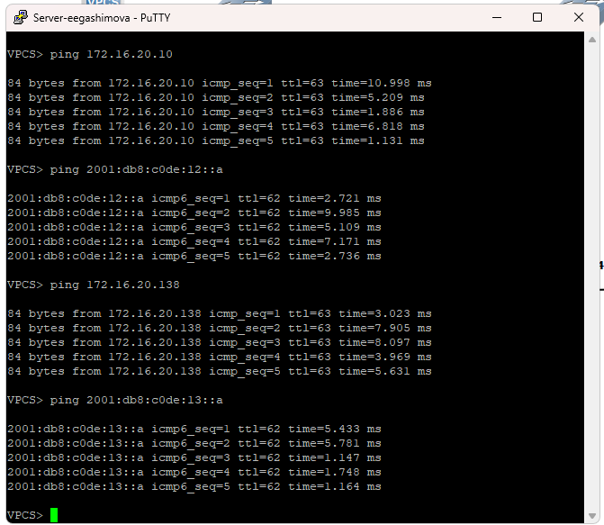{ #fig-017 width=75% }

Узлы PC1 и PC2 имеют только глобальную IPv4-адресацию, а PC3 и PC4 — только глобальную IPv6-адресацию. Поэтому устройства разных стеков непосредственно недоступны друг для друга. Сервер имеет адреса обоих семейств и может взаимодействовать с каждым из них.

### Анализ захваченного сетевого трафика

На соединении `Server-eegashimova` с коммутатором выполняю анализ ранее включённого захвата трафика.

В ARP-пакете виден ответ от шлюза `64.100.1.1`. В поле информации Wireshark отображается:

```text
64.100.1.1 is at 0c:39:cb:e8:00:02
```

Из ARP-пакета можно определить IPv4-адрес отправителя и соответствующий ему MAC-адрес, а также адрес узла, для которого предназначен ответ. В представленном кадре адрес `64.100.1.1` сопоставляется с MAC-адресом `0c:39:cb:e8:00:02`, а получателем является сервер с IP `64.100.1.10` и MAC `00:50:79:66:68:04` (см. рис. [@fig-018]).

ARP используется в IPv4-сети для определения канального адреса устройства, которому требуется передать Ethernet-кадр. В данном случае серверу необходимо знать MAC-адрес своего IPv4-шлюза.

{ #fig-018 width=90% }

В захвате ICMP присутствуют пары `Echo request` и `Echo reply` между сервером `64.100.1.10` и узлом `172.16.20.10`.

В выбранном ICMP Echo Reply можно определить:

- исходный IPv4-адрес — `172.16.20.10`;
- адрес назначения — `64.100.1.10`;
- значение TTL — `63`;
- протокол верхнего уровня — ICMP;
- тип ICMP — `Echo (ping) reply`, то есть `Type 0`;
- код — `0`;
- идентификатор запроса;
- порядковый номер пакета;
- контрольную сумму;
- время между соответствующими Echo Request и Echo Reply.

Для выбранного кадра Wireshark показывает время ответа около `4,267 ms`. По последовательности Echo Request/Echo Reply можно убедиться, что ICMP-проверка доступности проходит успешно (см. рис. [@fig-019]).

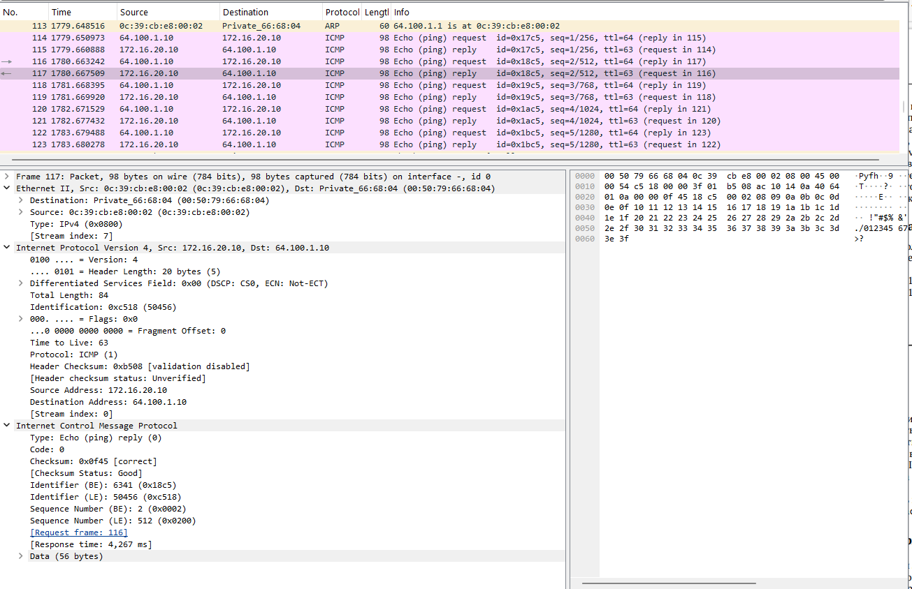{ #fig-019 width=90% }

В IPv6-части захвата присутствуют ICMPv6 Echo Request и Echo Reply между сервером `2001:db8:c0de:11::a` и PC3 `2001:db8:c0de:12::a`.

В выбранном Echo Request можно определить:

- IPv6-адрес источника — `2001:db8:c0de:11::a`;
- IPv6-адрес назначения — `2001:db8:c0de:12::a`;
- значение Hop Limit — `64`;
- следующий заголовок — ICMPv6;
- тип сообщения — `Echo (ping) request`, `Type 128`;
- код — `0`;
- идентификатор;
- номер последовательности;
- контрольную сумму.

В списке пакетов также присутствуют сообщения `Neighbor Solicitation`. Они являются частью протокола Neighbor Discovery для IPv6. В отличие от IPv4, где соответствие сетевого адреса MAC-адресу определяется при помощи ARP, IPv6 использует сообщения ICMPv6 Neighbor Solicitation и Neighbor Advertisement (см. рис. [@fig-020]).

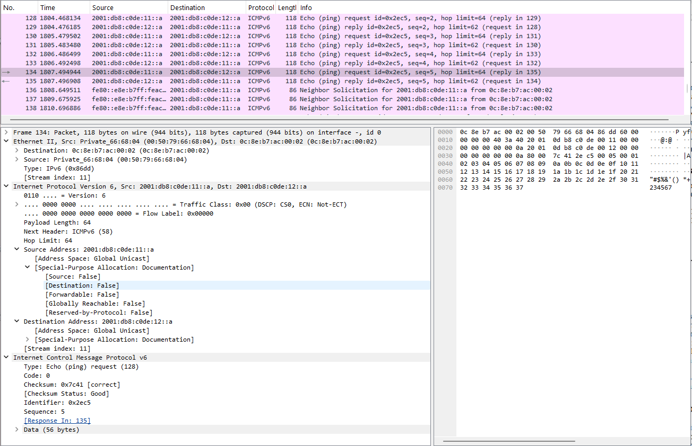{ #fig-020 width=90% }

По результатам захвата видно, что IPv4 и IPv6 используют разные механизмы служебного обмена. Для IPv4 сопоставление IP- и MAC-адресов выполняется ARP, а для IPv6 функции обнаружения соседей реализуются средствами ICMPv6. При этом непосредственно проверка доступности в IPv4 выполняется сообщениями ICMP Echo Request/Echo Reply, а в IPv6 — соответствующими сообщениями ICMPv6.

## Задание для самостоятельного выполнения

### Характеристика заданных подсетей

Для самостоятельного задания используются две локальные сети с двойным стеком:

- подсеть 1: `10.10.1.96/27` и `2001:db8:1:1::/64`;
- подсеть 2: `10.10.1.16/28` и `2001:db8:1:4::/64`.

Для сети `10.10.1.96/27` маска имеет вид `255.255.255.224`. Размер блока составляет 32 IPv4-адреса:

- адрес сети — `10.10.1.96`;
- минимальный адрес узла — `10.10.1.97`;
- максимальный адрес узла — `10.10.1.126`;
- широковещательный адрес — `10.10.1.127`;
- количество доступных адресов узлов — 30.

Для сети `10.10.1.16/28` используется маска `255.255.255.240`. Размер блока составляет 16 IPv4-адресов:

- адрес сети — `10.10.1.16`;
- минимальный адрес узла — `10.10.1.17`;
- максимальный адрес узла — `10.10.1.30`;
- широковещательный адрес — `10.10.1.31`;
- количество доступных адресов узлов — 14.

IPv6-подсеть `2001:db8:1:1::/64` содержит адреса с общими первыми 64 битами `2001:db8:1:1`. Диапазон адресов находится от `2001:db8:1:1::` до `2001:db8:1:1:ffff:ffff:ffff:ffff`.

Подсеть `2001:db8:1:4::/64` аналогично содержит адреса от `2001:db8:1:4::` до `2001:db8:1:4:ffff:ffff:ffff:ffff`. Каждая `/64` IPv6-подсеть содержит `2^64` вариантов интерфейсной части адреса. В IPv6 отсутствует широковещательная адресация; вместо неё используются multicast-механизмы.

В соответствии с условием для интерфейсов маршрутизатора выбираю минимальные доступные адреса IPv4 в каждой подсети — `10.10.1.97` и `10.10.1.17`. Для IPv6 назначаю интерфейсам адрес `::1`.

### Таблица адресации

Предлагаю следующую схему адресации:

| Устройство | Интерфейс | IPv4-адрес | IPv4-шлюз | IPv6-адрес | IPv6-маршрутизатор |
|---|---|---|---|---|---|
| `msk-eegashimova-gw-01` | `eth0` | `10.10.1.97/27` | — | `2001:db8:1:1::1/64` | — |
| `msk-eegashimova-gw-01` | `eth1` | `10.10.1.17/28` | — | `2001:db8:1:4::1/64` | — |
| `PC1-eegashimova` | NIC | `10.10.1.100/27` | `10.10.1.97` | `2001:db8:1:1::a/64` | VyOS через RA |
| `PC2-eegashimova` | NIC | `10.10.1.20/28` | `10.10.1.17` | `2001:db8:1:4::a/64` | VyOS через RA |

### Построение топологии самостоятельного задания

В GNS3 создаю топологию из маршрутизатора VyOS `msk-eegashimova-gw-01`, двух Ethernet-коммутаторов `msk-eegashimova-sw-01` и `msk-eegashimova-sw-02`, а также двух узлов `PC1-eegashimova` и `PC2-eegashimova`.

Каждый компьютер находится в отдельной локальной сети, а соединение между сетями выполняется маршрутизатором VyOS (см. рис. [@fig-021]).

{ #fig-021 width=80% }

### Настройка оконечных устройств

Для `PC1-eegashimova` назначаю IPv4-адрес `10.10.1.100/27` и шлюз `10.10.1.97`. Одновременно настраиваю IPv6-адрес `2001:db8:1:1::a/64`:

```text
ip 10.10.1.100/27 10.10.1.97
ip 2001:db8:1:1::a/64
save
```

Проверяю конфигурацию:

```text
show ip
show ipv6
```

В выводе отображаются IPv4-адрес `10.10.1.100/27`, шлюз `10.10.1.97` и глобальный IPv6-адрес `2001:db8:1:1::a/64`. Также присутствует link-local IPv6-адрес и канальный адрес обнаруженного маршрутизатора (см. рис. [@fig-022]).

{ #fig-022 width=70% }

На `PC2-eegashimova` использую адреса второй подсети:

```text
ip 10.10.1.20/28 10.10.1.17
ip 2001:db8:1:4::a/64
save
```

Проверяю параметры командами:

```text
show ip
show ipv6
```

PC2 получает IPv4-адрес `10.10.1.20/28`, шлюз `10.10.1.17` и IPv6-адрес `2001:db8:1:4::a/64` (см. рис. [@fig-023]).

{ #fig-023 width=70% }

### Настройка маршрутизатора VyOS

Перехожу в режим конфигурирования VyOS, задаю имя устройства и удаляю получение адреса по DHCP с `eth0`:

```text
configure
set system host-name msk-eegashimova-gw-01
delete interfaces ethernet eth0 address dhcp
compare
commit
save
```

В результате маршрутизатор получает имя `msk-eegashimova-gw-01`, а автоматически назначаемая DHCP-конфигурация интерфейса удаляется (см. рис. [@fig-024]).

{ #fig-024 width=75% }

Интерфейсу `eth0`, подключённому к первой подсети, назначаю минимальный доступный IPv4-адрес `10.10.1.97/27` и IPv6-адрес `2001:db8:1:1::1/64`.

Интерфейсу `eth1`, подключённому ко второй подсети, назначаю минимальный доступный IPv4-адрес `10.10.1.17/28` и IPv6-адрес `2001:db8:1:4::1/64`.

Одновременно включаю Router Advertisement для обеих IPv6-подсетей:

```text
configure

set interfaces ethernet eth0 address 10.10.1.97/27
set interfaces ethernet eth0 address 2001:db8:1:1::1/64
set service router-advert interface eth0 prefix 2001:db8:1:1::/64

set interfaces ethernet eth1 address 10.10.1.17/28
set interfaces ethernet eth1 address 2001:db8:1:4::1/64
set service router-advert interface eth1 prefix 2001:db8:1:4::/64

commit
save
```

Выбранные IPv4-адреса являются первыми доступными адресами узлов соответствующих подсетей, что соответствует требованиям задания (см. рис. [@fig-025]).

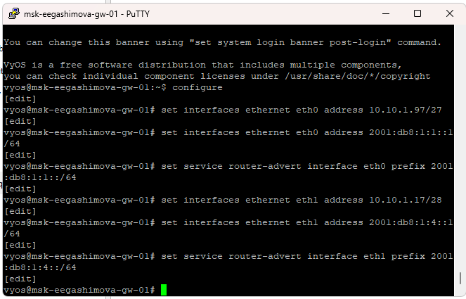{ #fig-025 width=75% }

Проверяю полученную конфигурацию:

```text
show interfaces
```

Для `eth0` отображаются адреса `10.10.1.97/27` и `2001:db8:1:1::1/64`, а для `eth1` — `10.10.1.17/28` и `2001:db8:1:4::1/64` (см. рис. [@fig-026]).

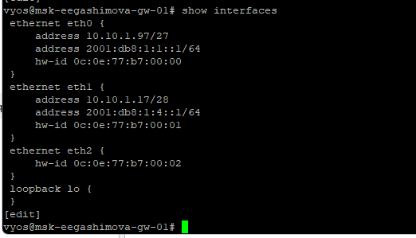{ #fig-026 width=70% }

### Проверка подключения между подсетями

С `PC1-eegashimova` проверяю IPv4-связь с PC2:

```text
ping 10.10.1.20
trace 10.10.1.20
```

PC2 успешно отвечает на все ICMP-запросы. В трассировке первым переходом является интерфейс маршрутизатора `10.10.1.97`, после чего достигается узел `10.10.1.20`.

Далее проверяю связь по IPv6:

```text
ping 2001:db8:1:4::a
trace 2001:db8:1:4::a
```

Получаю ответы ICMPv6 от PC2. Первый переход трассировки выполняется через `2001:db8:1:1::1`, после чего достигается `2001:db8:1:4::a` (см. рис. [@fig-027]).

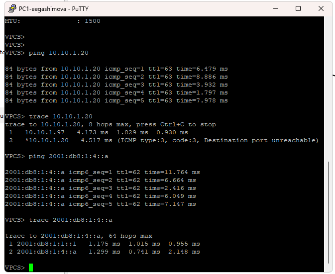{ #fig-027 width=75% }

Выполняю обратную проверку с `PC2-eegashimova`:

```text
ping 10.10.1.100
trace 10.10.1.100
```

Узел `10.10.1.100` отвечает на все запросы. В трассировке первым переходом является шлюз `10.10.1.17`, после чего достигается PC1.

Для IPv6 выполняю:

```text
ping 2001:db8:1:1::a
trace 2001:db8:1:1::a
```

При первой попытке ввода IPv6-адреса допускаю опечатку, поэтому VPCS выводит сообщение `Invalid address`. После исправления адреса получаю ответы на все ICMPv6-запросы. Трассировка проходит через `2001:db8:1:4::1` и завершается на `2001:db8:1:1::a` (см. рис. [@fig-028]).

{ #fig-028 width=75% }

В результате обе локальные сети работают с двойным стеком IPv4/IPv6. Маршрутизатор VyOS имеет минимальные доступные IPv4-адреса каждой подсети и адрес `::1` в каждой IPv6-подсети. Проверка `ping` и `trace` в обоих направлениях подтверждает корректность адресации и маршрутизации как для IPv4, так и для IPv6.

# Вывод

В ходе лабораторной работы была настроена сеть с поддержкой IPv4 и IPv6, выполнена адресация оконечных устройств и маршрутизаторов, а также проверена связность с помощью команд `ping` и `trace`. Был исследован сервер с двойным стеком и проанализирован трафик ARP, ICMP и ICMPv6. Результаты проверки подтвердили корректную работу настроенной адресации и маршрутизации.

# Список литературы

1. [GNS3 Documentation — создание первой топологии](https://docs.gns3.com/docs/getting-started/your-first-gns3-topology)
2. [GNS3 Documentation — Virtual PC Simulator (VPCS)](https://docs.gns3.com/docs/emulators/vpcs)
3. [FRRouting Documentation — настройка сетевых интерфейсов и IP-адресов](https://docs.frrouting.org/en/stable-10.6/zebra.html)
4. [VyOS Documentation — настройка Ethernet-интерфейсов и IPv4/IPv6-адресации](https://docs.vyos.io/en/1.5/configuration/interfaces/ethernet.html)
6. [RFC 8200 — Internet Protocol, Version 6 (IPv6) Specification](https://www.rfc-editor.org/rfc/rfc8200.html)
7. [RFC 4291 — IP Version 6 Addressing Architecture](https://www.rfc-editor.org/rfc/rfc4291.html)
8. [RFC 4861 — Neighbor Discovery for IP version 6 (IPv6)](https://www.rfc-editor.org/rfc/rfc4861.html)
9. [RFC 4443 — Internet Control Message Protocol (ICMPv6) for IPv6](https://www.rfc-editor.org/rfc/rfc4443.html)
11. [RFC 826 — Address Resolution Protocol (ARP)](https://www.rfc-editor.org/rfc/rfc826.html)
12. [Wireshark User’s Guide — анализ захваченных сетевых пакетов](https://www.wireshark.org/docs/wsug_html_chunked/index.html)
13. [Wireshark User’s Guide — фильтрация пакетов при анализе трафика](https://www.wireshark.org/docs/wsug_html_chunked/ChWorkDisplayFilterSection.html)