---
## Author
author:
  name: Гашимова Эсма Эльшан кызы
  email: 1132247520@rudn.ru
  affiliation:
    - name: Российский университет дружбы народов
      country: Российская Федерация
      postal-code: 117198
      city: Москва
      address: ул. Миклухо-Маклая, д. 6

## Title
title: "Отчёт по лабораторной работе №5"
subtitle: "Адресация IPv4 и IPv6. Настройка DHCP"
license: "CC BY"
---

# Цель работы

Получение навыков настройки службы DHCP на сетевом оборудовании для распределения адресов IPv4 и IPv6.

# Выполнение лабораторной работы

## Адресация IPv4 и IPv6. Настройка DHCP

### Настройка DHCP в сети IPv4

#### Построение топологии сети

Создаю проект в GNS3 и размещаю маршрутизатор VyOS, коммутатор Ethernet и клиент VPCS. Устройствам присваиваю имена с использованием учётной записи `eegashimova`. На соединении маршрутизатора с коммутатором включаю захват трафика для анализа DHCP (см. рис. [@fig-001]).

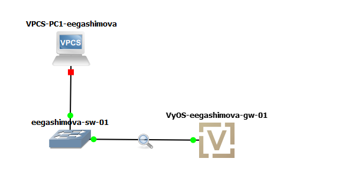{ #fig-001 width=80% }

#### Настройка маршрутизатора VyOS

Перехожу в режим конфигурирования, задаю имя маршрутизатора, домен и создаю пользователя `eegashimova`. Удаляю получение адреса по DHCP на интерфейсе `eth0` и сохраняю изменения:

```text
configure
set system host-name eegashimova-gw-01
set system domain-name eegashimova.net
set system login user eegashimova authentication plaintext-password <пароль>
delete interfaces ethernet eth0 address dhcp
commit
save
```

После настройки выполняю дальнейшие действия под созданным пользователем (см. рис. [@fig-002]).

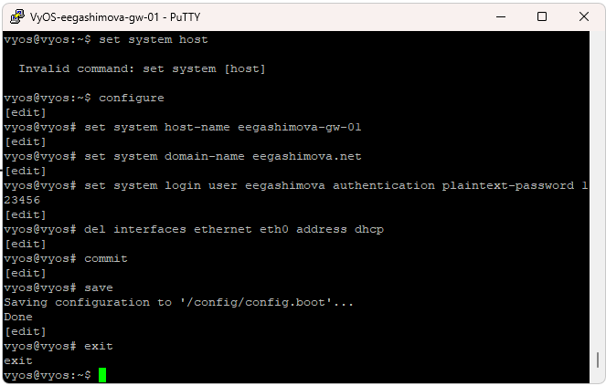{ #fig-002 width=75% }

#### Настройка DHCP-сервера IPv4

Назначаю интерфейсу `eth0` адрес `10.0.0.1/24` и создаю DHCP-пул `10.0.0.2–10.0.0.253`. В качестве шлюза и DNS-сервера указываю `10.0.0.1`.

```text
set interfaces ethernet eth0 address 10.0.0.1/24
set service dhcp-server shared-network-name eegashimova domain-name eegashimova.net
set service dhcp-server shared-network-name eegashimova name-server 10.0.0.1
set service dhcp-server shared-network-name eegashimova subnet 10.0.0.0/24 default-router 10.0.0.1
set service dhcp-server shared-network-name eegashimova subnet 10.0.0.0/24 range hosts start 10.0.0.2
set service dhcp-server shared-network-name eegashimova subnet 10.0.0.0/24 range hosts stop 10.0.0.253
commit
save
```

Конфигурация обеспечивает автоматическую выдачу IPv4-адресов и сетевых параметров клиентам (см. рис. [@fig-003]).

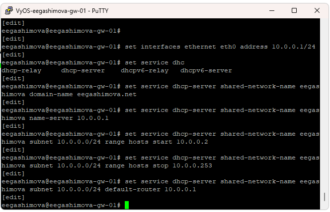{ #fig-003 width=75% }

#### Получение адреса на VPCS

На устройстве `VPCS-PC1-eegashimova` запускаю DHCP-клиент с отображением декодированных сообщений:

```text
ip dhcp -d
save
```

В консоли появляются сообщения `DHCP Discover`, содержащие MAC-адрес клиента `00:50:79:66:68:00`. На начальном этапе IPv4-адрес отсутствует, поэтому используется `0.0.0.0` (см. рис. [@fig-004]).

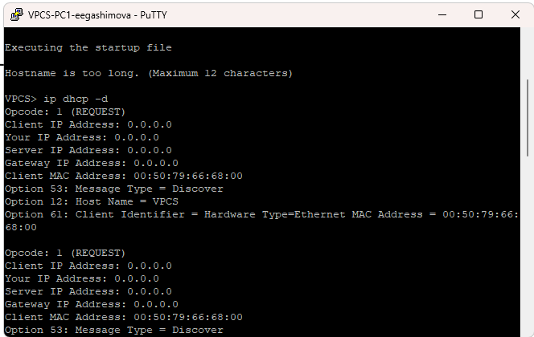{ #fig-004 width=75% }

Проверяю назначенные параметры и доступность маршрутизатора:

```text
show ip
ping 10.0.0.1 -c 2
```

Клиент получает адрес `10.0.0.2/24`, шлюз `10.0.0.1`, DNS-сервер `10.0.0.1` и домен `eegashimova.net`. Оба ICMP-запроса завершаются успешно (см. рис. [@fig-005]).

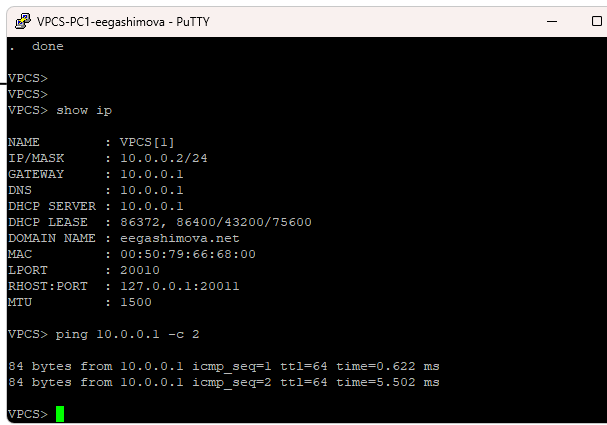{ #fig-005 width=75% }

#### Проверка DHCP-сервера

На маршрутизаторе просматриваю статистику и таблицу аренд:

```text
show dhcp server statistics
show dhcp server leases
```

В пуле доступно 252 адреса, один выдан клиенту, 251 остаётся свободным. В таблице отображается активная аренда `10.0.0.2` для MAC-адреса `00:50:79:66:68:00` (см. рис. [@fig-006]).

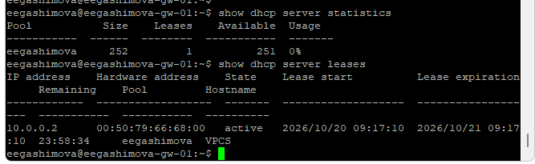{ #fig-006 width=75% }

Затем проверяю журнал DHCP:

```text
show log | grep dhcp
```

В журнале наблюдаю последовательность `DHCPDISCOVER`, `DHCPOFFER`, `DHCPREQUEST` и `DHCPACK`, подтверждающую успешное выделение адреса `10.0.0.2` (см. рис. [@fig-007]).

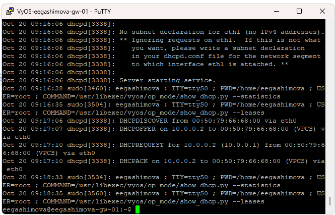{ #fig-007 width=75% }

#### Анализ DHCP-пакетов в Wireshark

Открываю захват трафика и применяю фильтр:

```text
dhcp
```

В пакете `DHCP Discover` клиент отправляет широковещательный запрос с адреса `0.0.0.0` на `255.255.255.255` через UDP-порты 68 и 67. Сообщение содержит идентификатор клиента и его MAC-адрес (см. рис. [@fig-008]).

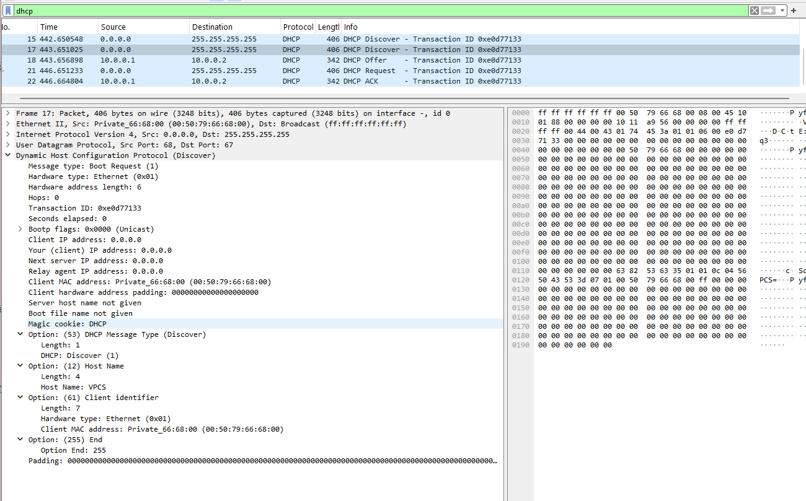{ #fig-008 width=90% }

В ответ сервер отправляет `DHCP Offer`, предлагая адрес `10.0.0.2`, маску `255.255.255.0`, шлюз и DNS `10.0.0.1`. Время аренды составляет `86400` секунд (см. рис. [@fig-009]).

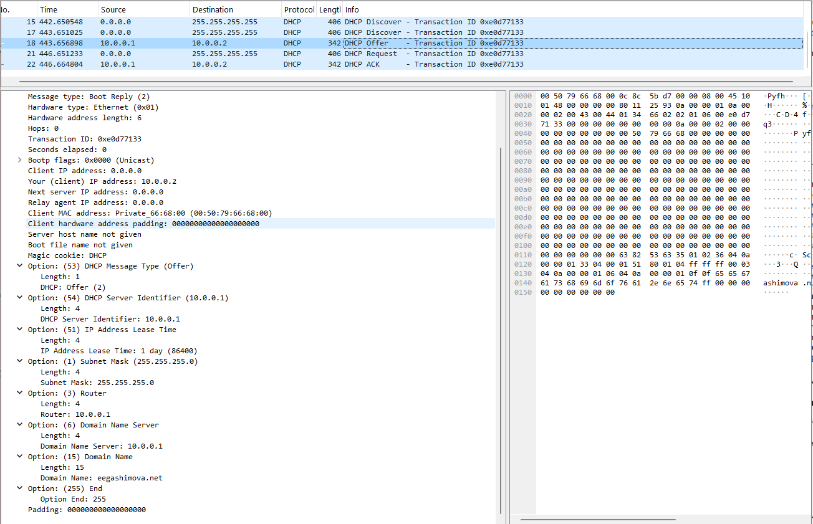{ #fig-009 width=90% }

Клиент отправляет `DHCP Request`, подтверждая выбор предложенного адреса. В параметрах пакета указываются `Requested IP Address: 10.0.0.2` и `DHCP Server Identifier: 10.0.0.1` (см. рис. [@fig-010]).

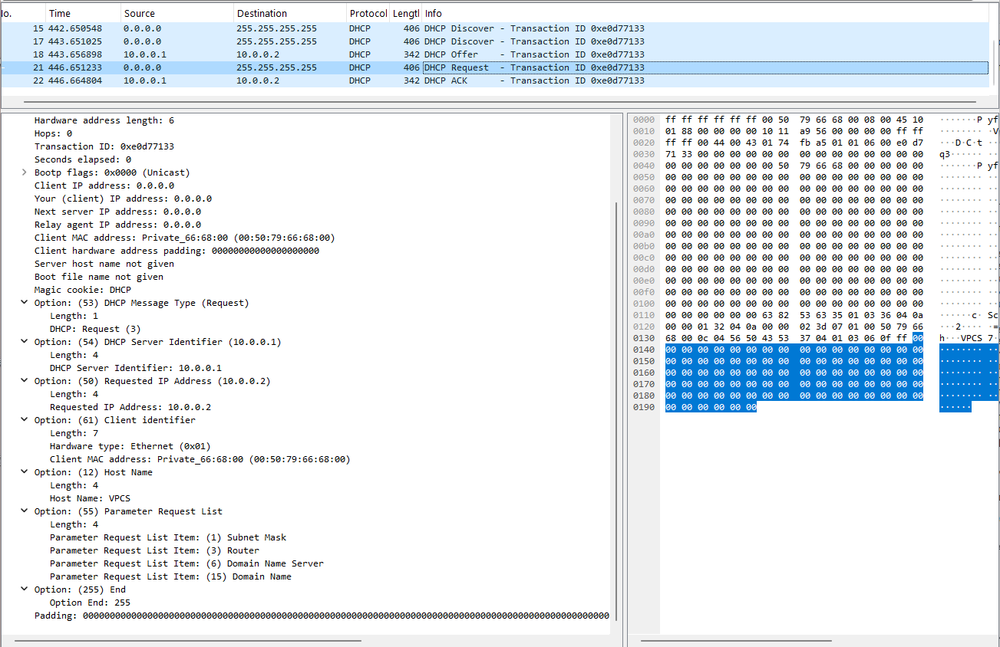{ #fig-010 width=90% }

Сервер завершает обмен сообщением `DHCP ACK`, подтверждая аренду адреса `10.0.0.2`. В результате наблюдаю полный цикл DHCP DORA: Discover, Offer, Request, ACK (см. рис. [@fig-011]).

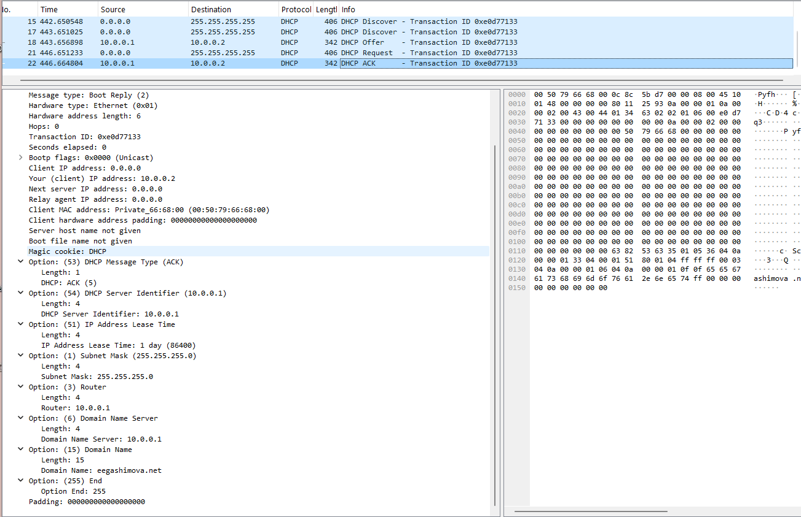{ #fig-011 width=90% }

### Настройка DHCP в сети IPv6

#### Расширение топологии

Дополняю проект двумя IPv6-сегментами. К маршрутизатору подключаю коммутаторы `eegashimova-sw-02` и `eegashimova-sw-03`, а к ним — устройства Alpine Linux и AlmaLinux.

Для сети `2000::/64` использую Stateless DHCPv6, для `2001::/64` — Stateful DHCPv6. На соединениях с маршрутизатором включаю захват трафика (см. рис. [@fig-012]).

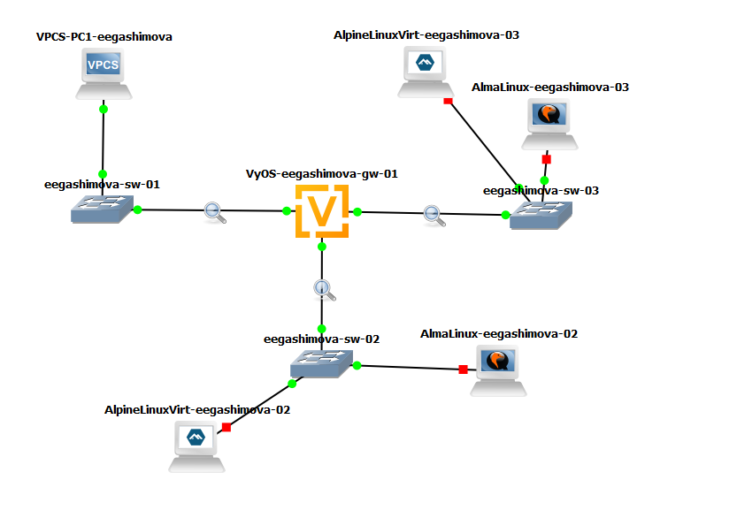{ #fig-012 width=85% }

#### Настройка IPv6-адресации

На маршрутизаторе назначаю интерфейсам адреса `2000::1/64` и `2001::1/64`:

```text
configure
set interfaces ethernet eth1 address 2000::1/64
set interfaces ethernet eth2 address 2001::1/64
show interfaces
commit
save
```

Интерфейс `eth0` продолжает использовать IPv4-адрес `10.0.0.1/24` (см. рис. [@fig-013]).

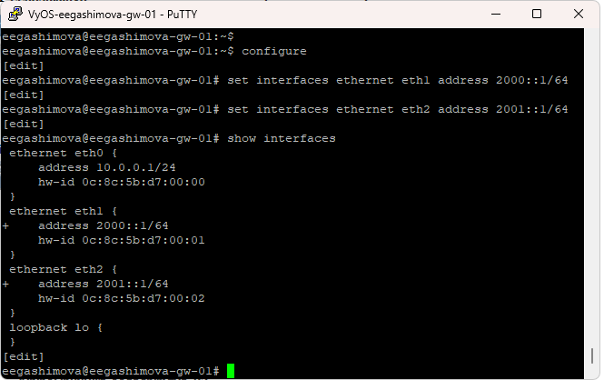{ #fig-013 width=75% }

### Настройка Stateless DHCPv6

#### Конфигурирование сервера

На интерфейсе `eth1` включаю Router Advertisement с префиксом `2000::/64` и флагом `other-config-flag`. Этот режим позволяет клиентам получать IPv6-адрес через SLAAC, а DNS-параметры — через DHCPv6.

```text
set service router-advert interface eth1 prefix 2000::/64
set service router-advert interface eth1 other-config-flag
set service dhcpv6-server shared-network-name eegashimova-stateless
set service dhcpv6-server shared-network-name eegashimova-stateless subnet 2000::0/64
set service dhcpv6-server shared-network-name eegashimova-stateless common-options name-server 2000::1
set service dhcpv6-server shared-network-name eegashimova-stateless common-options domain-search eegashimova.net
commit
save
```

Настраиваю DNS-сервер `2000::1` и домен `eegashimova.net` (см. рис. [@fig-014]).

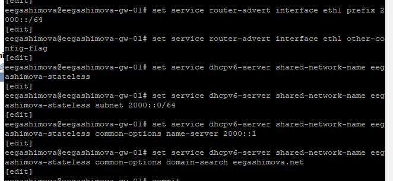{ #fig-014 width=75% }

#### Проверка клиентов

На устройстве Alpine Linux выполняю:

```text
ip address
ip -6 route show
ping 2000::1 -c 2
cat /etc/resolv.conf
```

Интерфейс получает адрес `2000::eb4:82ff:fe19:0/64` через SLAAC. Маршрут по умолчанию указывает на link-local адрес маршрутизатора. Ping проходит успешно, но в DNS-конфигурации остаётся сервер `10.0.2.3` (см. рис. [@fig-015]).

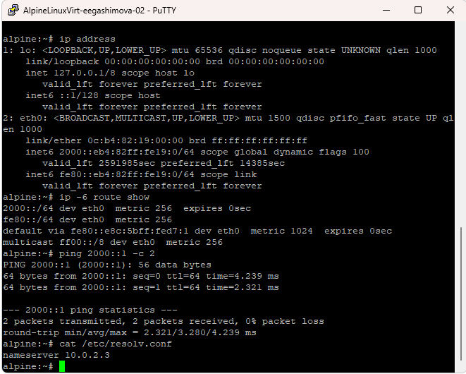{ #fig-015 width=75% }

Аналогичные команды выполняю на AlmaLinux. Устройство получает адрес `2000::ea0:d1ff:fe21:0/64`, а в `/etc/resolv.conf` отображаются:

```text
search eegashimova.net
nameserver 2000::1
```

Это подтверждает получение адреса через SLAAC и дополнительных DNS-параметров через DHCPv6. Проверка связи с `2000::1` завершается успешно (см. рис. [@fig-016]).

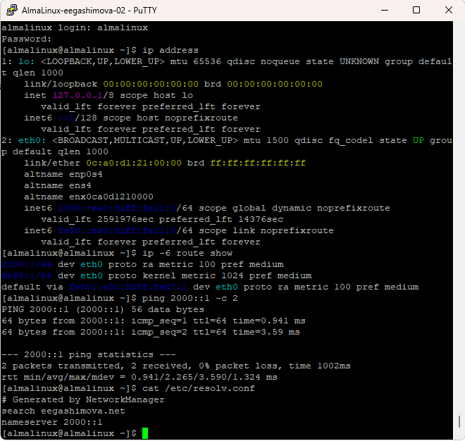{ #fig-016 width=75% }

На маршрутизаторе проверяю аренды:

```text
run show dhcpv6 server leases
```

Таблица остаётся пустой, поскольку Stateless DHCPv6 не выделяет IPv6-адреса и не ведёт их учёт (см. рис. [@fig-017]).

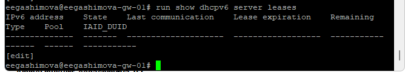{ #fig-017 width=75% }

#### Анализ Stateless DHCPv6 в Wireshark

Применяю фильтр:

```text
dhcpv6
```

Клиент AlmaLinux отправляет `Information-request` на multicast-адрес `ff02::1:2`, используя UDP-порты 546 и 547. В сообщении запрашиваются DNS-сервер, домен поиска и дополнительные параметры (см. рис. [@fig-018]).

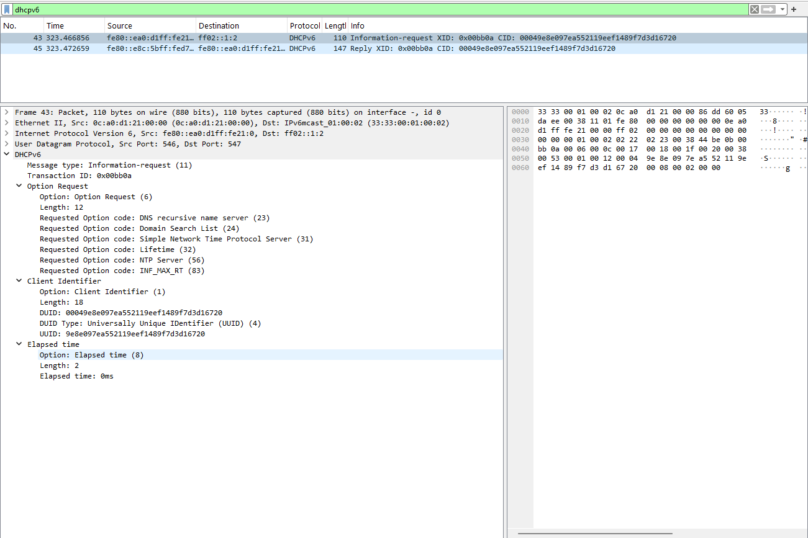{ #fig-018 width=90% }

Маршрутизатор отвечает сообщением `Reply`, передавая адрес DNS-сервера `2000::1` и домен `eegashimova.net`. IPv6-адрес в ответе не выделяется, что соответствует режиму Stateless DHCPv6 (см. рис. [@fig-019]).

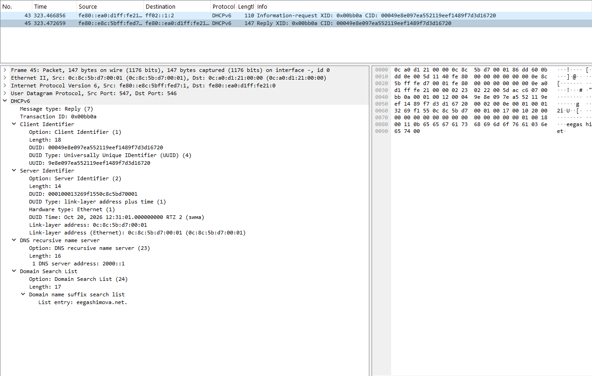{ #fig-019 width=90% }

### Настройка Stateful DHCPv6

#### Конфигурирование сервера

Для интерфейса `eth2` включаю `managed-flag`, указывающий клиентам на необходимость получения IPv6-адресов через DHCPv6.

Создаю пул `2001::100–2001::199` и задаю DNS-сервер `2001::1`:

```text
set service router-advert interface eth2 managed-flag
set service dhcpv6-server shared-network-name eegashimova-stateful
set service dhcpv6-server shared-network-name eegashimova-stateful subnet 2001::0/64
set service dhcpv6-server shared-network-name eegashimova-stateful subnet 2001::0/64 name-server 2001::1
set service dhcpv6-server shared-network-name eegashimova-stateful subnet 2001::0/64 domain-search eegashimova.net
set service dhcpv6-server shared-network-name eegashimova-stateful subnet 2001::0/64 address-range start 2001::100 stop 2001::199
commit
save
```

DHCPv6-сервер теперь может распределять адреса и отслеживать активные аренды (см. рис. [@fig-020]).

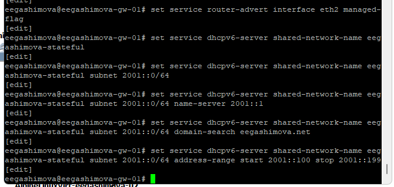{ #fig-020 width=75% }

#### Получение адреса на Alpine Linux

На клиенте Alpine Linux первоначально проверяю интерфейс и маршруты:

```text
ip address
ip -6 route show
cat /etc/resolv.conf
```

Глобальный IPv6-адрес отсутствует. Запускаю DHCPv6-клиент:

```text
udhcpc6 -i eth0
```

В консоли появляется сообщение `IPv6 obtained, lease time 43200`, подтверждающее получение аренды сроком 12 часов (см. рис. [@fig-021]).

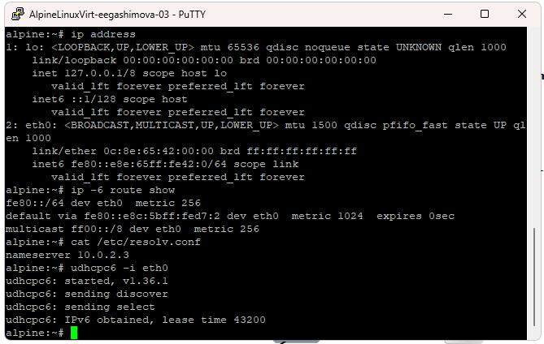{ #fig-021 width=75% }

Повторно выполняю:

```text
ip address
ip -6 route show
ping 2001::1 -c 2
cat /etc/resolv.conf
```

Связь с маршрутизатором работает, а DNS изменяется на `2001::1` с доменом `eegashimova.net`. Однако глобальный IPv6-адрес в выводе `ip address` не отображается, несмотря на успешное получение аренды (см. рис. [@fig-022]).

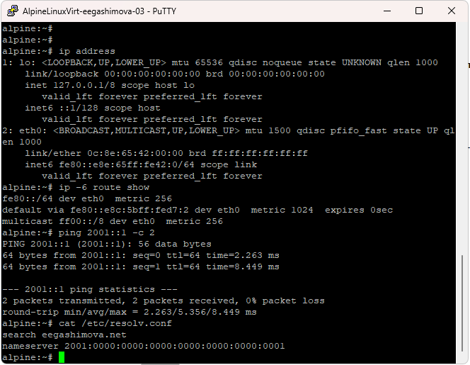{ #fig-022 width=75% }

#### Проверка AlmaLinux

На устройстве AlmaLinux выполняю те же команды проверки.

```text
ip address
ip -6 route show
ping 2001::1 -c 2
cat /etc/resolv.conf
```

Клиент получает динамический адрес `2001::198/128`, DNS-сервер `2001::1` и домен `eegashimova.net`. Шлюз по умолчанию определяется через Router Advertisement. Оба ICMPv6-запроса проходят успешно (см. рис. [@fig-023]).

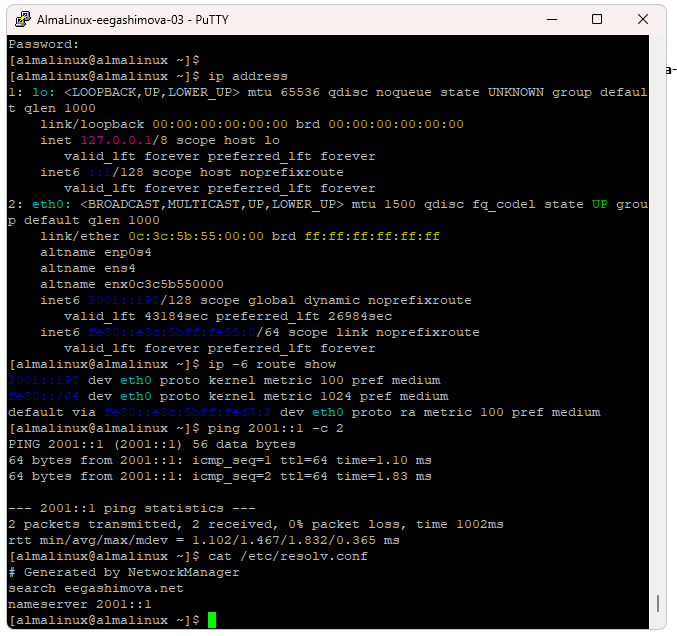{ #fig-023 width=75% }

#### Проверка DHCPv6-аренд

На маршрутизаторе выполняю:

```text
run show dhcpv6 server leases
```

В таблице отображаются две активные аренды: `2001::198` для AlmaLinux и `2001::199` для Alpine Linux. Также указаны идентификаторы клиентов и время окончания аренды. Это подтверждает работу Stateful DHCPv6 с учётом выделенных адресов (см. рис. [@fig-024]).

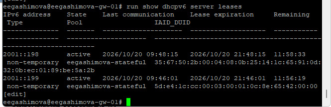{ #fig-024 width=75% }

#### Анализ Stateful DHCPv6 в Wireshark

Открываю захваченный трафик и применяю фильтр:

```text
dhcpv6
```

Клиент отправляет сообщение `Solicit` на адрес `ff02::1:2` для поиска DHCPv6-сервера. В пакете присутствуют `Client Identifier`, `IA_NA` и список запрашиваемых параметров (см. рис. [@fig-025]).

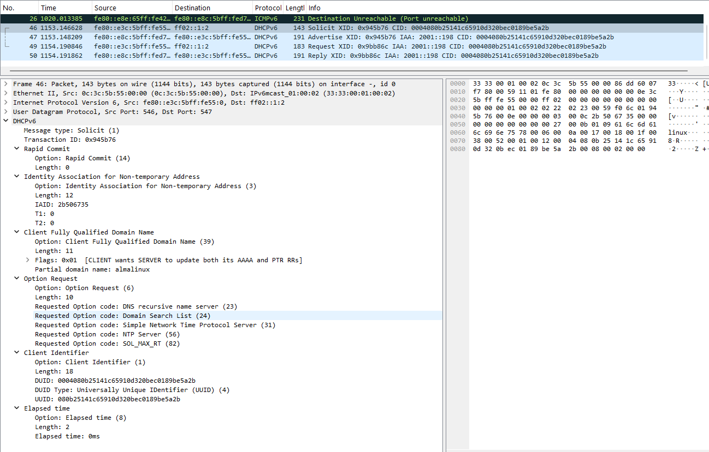{ #fig-025 width=90% }

Сервер отвечает сообщением `Advertise`, предлагая IPv6-адрес `2001::198`. Предпочтительное время использования составляет `27000` секунд, срок действительности — `43200` секунд. Дополнительно передаются DNS-сервер и домен поиска (см. рис. [@fig-026]).

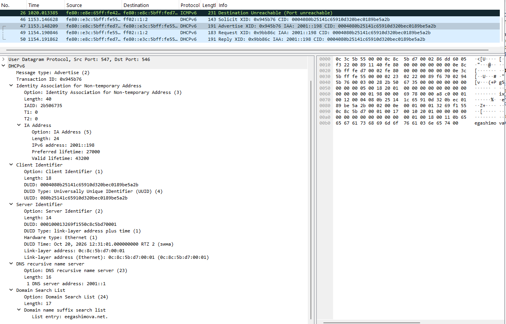{ #fig-026 width=90% }

Клиент отправляет `Request`, запрашивая выделение адреса `2001::198` у выбранного сервера. В сообщении содержатся идентификаторы клиента, сервера и ассоциации адресов `IA_NA` (см. рис. [@fig-027]).

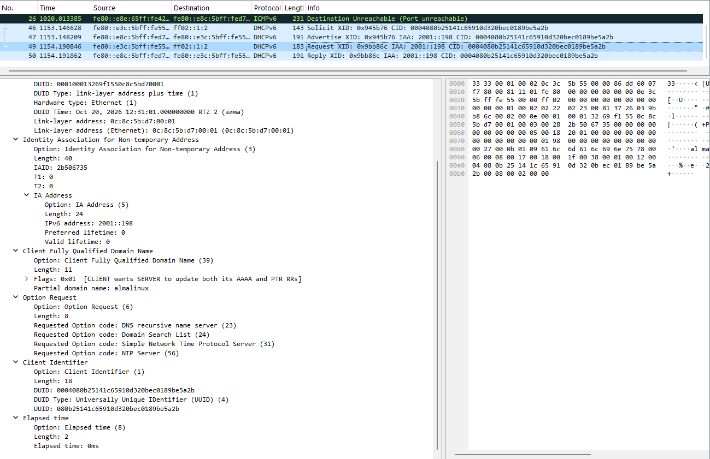{ #fig-027 width=90% }

В завершение сервер отправляет `Reply`, подтверждая выделение адреса `2001::198` и передавая параметры аренды, DNS `2001::1` и домен `eegashimova.net`.

Последовательность `Solicit → Advertise → Request → Reply` подтверждает успешную работу Stateful DHCPv6 (см. рис. [@fig-028]).

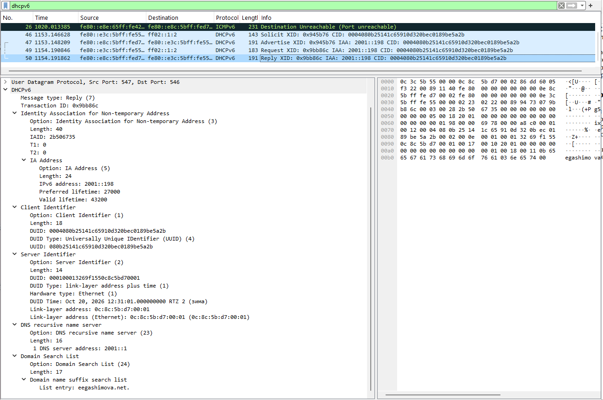{ #fig-028 width=90% }

# Вывод

В ходе лабораторной работы настраиваю DHCP для IPv4 и IPv6 в среде GNS3.

В IPv4-сети клиент VPCS автоматически получает адрес `10.0.0.2/24`, а анализ Wireshark подтверждает обмен Discover, Offer, Request и ACK.

Для IPv6 исследую два режима. В **Stateless DHCPv6** адреса формируются через SLAAC, а DHCPv6 передаёт дополнительные параметры без учёта аренд. В **Stateful DHCPv6** сервер выделяет адреса из диапазона `2001::100–2001::199` и сохраняет сведения о клиентах.

Проверяю конфигурации Alpine Linux и AlmaLinux, доступность маршрутизатора, DNS-параметры и таблицы аренд. Анализ пакетов позволяет установить различия между механизмами автоматической настройки IPv4 и IPv6.

# Список литературы

1. [GNS3 Documentation — создание сетевой топологии в GNS3](https://docs.gns3.com/docs/getting-started/your-first-gns3-topology)
2. [GNS3 Documentation — Virtual PC Simulator (VPCS), настройка DHCP-клиента](https://docs.gns3.com/docs/emulators/vpcs)
3. [VyOS Documentation — настройка DHCP-сервера для IPv4 и IPv6](https://docs.vyos.io/en/1.5/configuration/service/dhcp-server.html)
4. [VyOS Documentation — настройка Router Advertisements и автоматической IPv6-адресации](https://docs.vyos.io/en/1.5/configuration/service/router-advert.html)
5. [RFC 2131 — Dynamic Host Configuration Protocol (DHCP)](https://www.rfc-editor.org/rfc/rfc2131.html)
6. [RFC 8415 — Dynamic Host Configuration Protocol for IPv6 (DHCPv6)](https://www.rfc-editor.org/rfc/rfc8415.html)
7. [RFC 4862 — IPv6 Stateless Address Autoconfiguration (SLAAC)](https://www.rfc-editor.org/rfc/rfc4862.html)
8. [RFC 4861 — Neighbor Discovery for IP Version 6 (IPv6), сообщения Router Advertisement](https://www.rfc-editor.org/rfc/rfc4861.html)
9. [Wireshark User’s Guide — анализ и фильтрация сетевых пакетов DHCP и DHCPv6](https://www.wireshark.org/docs/wsug_html_chunked/ChWorkDisplayFilterSection.html)