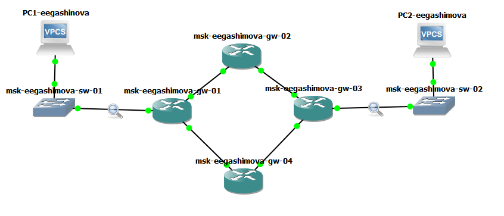
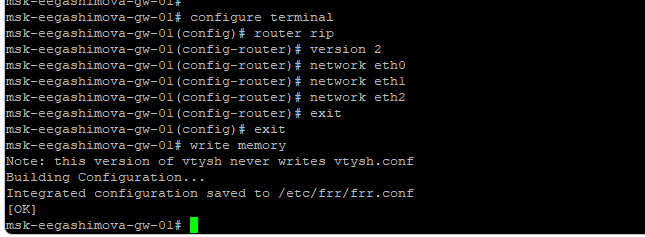
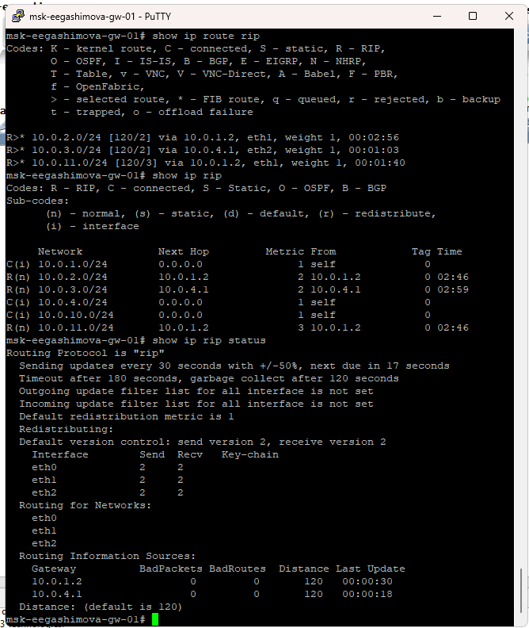

---
## Author
author:
  name: Гашимова Эсма Эльшан кызы
  email: 1132247520@rudn.ru
  affiliation:
    - name: Российский университет дружбы народов
      country: Российская Федерация
      postal-code: 117198
      city: Москва
      address: ул. Миклухо-Маклая, д. 6

## Title
title: Лабораторная работа №6
subtitle: Адресация IPv4 и IPv6. Настройка маршрутизации по протоколу RIP
license: CC BY
date: today
date-format: "YYYY-MM-DD"
---

# Цели и задачи работы

## Цель лабораторной работы

Изучение динамической маршрутизации по протоколам RIPv2 и RIPng.

Настройка маршрутизаторов FRRouting в GNS3.

Проверка связности, маршрутов и отказоустойчивости сети.

Анализ пакетов RIP в Wireshark.

# Построение сети

## Топология сети в GNS3

{ #fig:001 width=85% height=70% }

## Схема адресации L3

{ #fig:002 width=85% height=70% }

# Настройка RIPv2

## Конфигурирование RIPv2

{ #fig:003 width=75% height=65% }

## Проверка маршрутов RIPv2

{ #fig:004 width=80% height=70% }

## Проверка IPv4-связности

{ #fig:005 width=80% height=65% }

# Проверка отказоустойчивости RIPv2

## Переключение на резервный маршрут

{ #fig:006 width=80% height=65% }

# Анализ RIPv2 в Wireshark

## Маршрутные обновления

{ #fig:007 width=90% height=70% }

# Настройка RIPng

## Конфигурирование RIPng

{ #fig:008 width=75% height=65% }

## Проверка IPv6-связности

{ #fig:009 width=80% height=65% }

# Проверка отказоустойчивости RIPng

## Изменение IPv6-маршрута

{ #fig:010 width=80% height=65% }

# Анализ RIPng в Wireshark

## Маршрутные обновления IPv6

{ #fig:011 width=90% height=70% }

# Самостоятельное задание

## Топология сети

{ #fig:012 width=85% height=70% }

## Настройка и проверка маршрутизации

{ #fig:013 width=80% height=70% }

## Проверка связности

{ #fig:014 width=80% height=70% }

# Результаты работы

## Полученные результаты

Настроены сети IPv4 и IPv6 в GNS3.

Реализована маршрутизация RIPv2 и RIPng.

Проверены связность и резервные маршруты.

Проанализированы пакеты RIP в Wireshark.

Выполнено самостоятельное задание.

## Вывод

В ходе работы была построена сеть с поддержкой IPv4 и IPv6.

Настроены протоколы RIPv2 и RIPng, проверены таблицы маршрутизации и связность устройств.

Исследовано переключение на резервные маршруты и проанализирован сетевой трафик в Wireshark.

Выполнено самостоятельное задание с изменённой адресацией.