---
## Author
author:
  name: Гашимова Эсма Эльшан кызы
  email: 1132247520@rudn.ru
  affiliation:
    - name: Российский университет дружбы народов
      country: Российская Федерация
      postal-code: 117198
      city: Москва
      address: ул. Миклухо-Маклая, д. 6

## Title
title: "Отчёт по лабораторной работе №6"
subtitle: "Адресация IPv4 и IPv6. Настройка маршрутизации по протоколу RIP"
license: "CC BY"
---

# Цель работы

Изучение принципов маршрутизации по протоколу RIP в IPv4- и IPv6-сетях и принципов настройки сетевого оборудования.

# Выполнение лабораторной работы № 6

## Адресация IPv4 и IPv6. Настройка маршрутизации по протоколу RIP

### Цель работы

Изучение принципов динамической маршрутизации по протоколам RIPv2 и RIPng в сетях IPv4 и IPv6, освоение настройки маршрутизаторов FRRouting в GNS3, анализ таблиц маршрутизации, проверка доступности сетевых узлов и исследование процесса перестроения маршрутов при изменении состояния сетевых соединений.

### Настройка динамической маршрутизации в сетях IPv4 и IPv6

#### Документирование моделируемой сети

В соответствии с заданием разрабатываю сеть, состоящую из четырёх маршрутизаторов FRRouting, двух коммутаторов Ethernet и двух оконечных устройств VPCS. Маршрутизаторы соединяю по кольцевой топологии, обеспечивающей наличие двух альтернативных путей между клиентскими подсетями.

Для адресации использую следующие сети:

| Соединение | Сеть IPv4 | Сеть IPv6 |
|---|---|---|
| PC1 — gw-01 | 10.0.10.0/24 | 2001:10::/64 |
| PC2 — gw-03 | 10.0.11.0/24 | 2001:11::/64 |
| gw-01 — gw-02 | 10.0.1.0/24 | 2001:1::/64 |
| gw-02 — gw-03 | 10.0.2.0/24 | 2001:2::/64 |
| gw-03 — gw-04 | 10.0.3.0/24 | 2001:3::/64 |
| gw-04 — gw-01 | 10.0.4.0/24 | 2001:4::/64 |

Адреса сетевых интерфейсов назначаю согласно таблице адресации:

| Устройство | Интерфейс | IPv4-адрес | IPv6-адрес |
|---|---|---|---|
| gw-01 | eth0 | 10.0.10.1/24 | 2001:10::1/64 |
| gw-01 | eth1 | 10.0.1.1/24 | 2001:1::1/64 |
| gw-01 | eth2 | 10.0.4.2/24 | 2001:4::2/64 |
| gw-02 | eth0 | 10.0.1.2/24 | 2001:1::2/64 |
| gw-02 | eth1 | 10.0.2.1/24 | 2001:2::1/64 |
| gw-03 | eth0 | 10.0.11.1/24 | 2001:11::1/64 |
| gw-03 | eth1 | 10.0.2.2/24 | 2001:2::2/64 |
| gw-03 | eth2 | 10.0.3.1/24 | 2001:3::1/64 |
| gw-04 | eth0 | 10.0.3.2/24 | 2001:3::2/64 |
| gw-04 | eth1 | 10.0.4.1/24 | 2001:4::1/64 |
| PC1 | NIC | 10.0.10.10/24 | 2001:10::a/64 |
| PC2 | NIC | 10.0.11.10/24 | 2001:11::a/64 |

Для PC1 указываю шлюз IPv4 `10.0.10.1`, для PC2 — `10.0.11.1`.

Разрабатываю схему физической топологии L1, на которой отображаю устройства, соединения между ними и номера используемых интерфейсов (см. рис. [@fig-l1]).

{ #fig-l1 width=85% }

Затем создаю схему L3, отражающую распределение адресного пространства IPv4 и IPv6 между сегментами сети (см. рис. [@fig-l3]).

{ #fig-l3 width=85% }

#### Построение топологии сети в GNS3

Запускаю GNS3 и создаю новый проект для исследования динамической маршрутизации. Размещаю четыре маршрутизатора FRRouting, два коммутатора Ethernet и два устройства VPCS.

Устройствам присваиваю имена с использованием учётной записи `eegashimova`:

- `msk-eegashimova-gw-01` — `msk-eegashimova-gw-04` — маршрутизаторы;
- `msk-eegashimova-sw-01` и `msk-eegashimova-sw-02` — коммутаторы;
- `PC1-eegashimova` и `PC2-eegashimova` — клиентские устройства.

Соединяю маршрутизаторы по кольцевой топологии. Клиент PC1 подключаю к `gw-01` через первый коммутатор, а PC2 — к `gw-03` через второй.

На соединениях коммутаторов с маршрутизаторами включаю захват трафика для последующего анализа протоколов маршрутизации в Wireshark (см. рис. [@fig-001]).

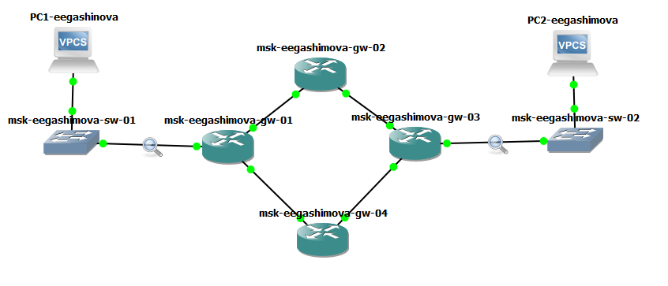{ #fig-001 width=85% }

#### Настройка IPv4-адресов на клиентских устройствах

На устройстве `PC1-eegashimova` назначаю IPv4-адрес `10.0.10.10/24` и шлюз по умолчанию `10.0.10.1`.

```text
ip 10.0.10.10/24 10.0.10.1
save
show ip
```

Команда `show ip` подтверждает назначение адреса `10.0.10.10/24` и шлюза `10.0.10.1`. Конфигурация успешно сохраняется в файле `startup.vpc` (см. рис. [@fig-002]).

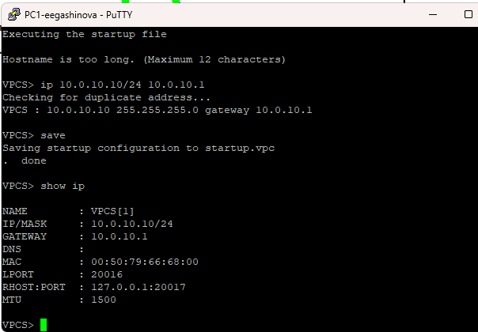{ #fig-002 width=75% }

Аналогично настраиваю устройство `PC2-eegashimova`:

```text
ip 10.0.11.10/24 10.0.11.1
save
show ip
```

Проверяю параметры сетевого интерфейса. Клиент получает статический адрес `10.0.11.10/24` и использует маршрутизатор `10.0.11.1` в качестве шлюза (см. рис. [@fig-003]).

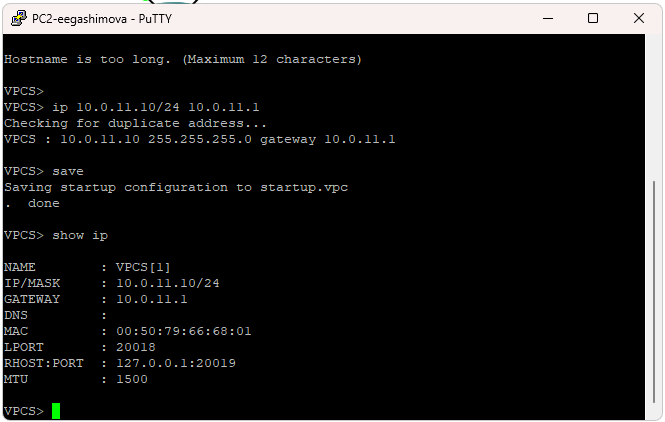{ #fig-003 width=75% }

#### Настройка IPv4-адресов маршрутизатора gw-01

Открываю консоль маршрутизатора `msk-eegashimova-gw-01`, перехожу в режим конфигурирования и задаю имя устройства.

Назначаю адреса трём сетевым интерфейсам:

```text
configure terminal
hostname msk-eegashimova-gw-01

interface eth0
ip address 10.0.10.1/24
no shutdown
exit

interface eth1
ip address 10.0.1.1/24
no shutdown
exit

interface eth2
ip address 10.0.4.2/24
no shutdown
exit

exit
write memory
```

Интерфейс `eth0` обеспечивает подключение локальной сети PC1, `eth1` соединяет маршрутизатор с `gw-02`, а `eth2` — с `gw-04`.

После ввода команды `write memory` конфигурация сохраняется в `/etc/frr/frr.conf`, что подтверждается сообщением `[OK]` (см. рис. [@fig-004]).

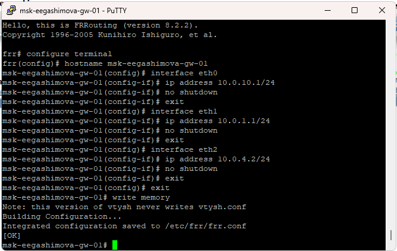{ #fig-004 width=75% }

#### Настройка IPv4-адресов маршрутизатора gw-02

На маршрутизаторе `msk-eegashimova-gw-02` настраиваю два интерфейса для соединения с соседними маршрутизаторами:

```text
configure terminal
hostname msk-eegashimova-gw-02

interface eth0
ip address 10.0.1.2/24
no shutdown
exit

interface eth1
ip address 10.0.2.1/24
no shutdown
exit

exit
write memory
```

Интерфейс `eth0` подключается к сети `10.0.1.0/24`, а `eth1` — к сети `10.0.2.0/24`. Изменения сохраняются успешно (см. рис. [@fig-005]).

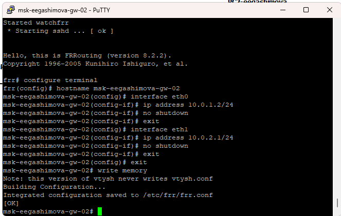{ #fig-005 width=75% }

#### Настройка IPv4-адресов маршрутизатора gw-03

Перехожу к конфигурированию `msk-eegashimova-gw-03`. Данный маршрутизатор обеспечивает подключение локальной сети PC2 и взаимодействие с маршрутизаторами `gw-02` и `gw-04`.

```text
configure terminal
hostname msk-eegashimova-gw-03

interface eth0
ip address 10.0.11.1/24
no shutdown
exit

interface eth1
ip address 10.0.2.2/24
no shutdown
exit

interface eth2
ip address 10.0.3.1/24
no shutdown
exit

exit
write memory
```

Проверяю сохранение конфигурации и соответствие назначенных адресов таблице адресации (см. рис. [@fig-006]).

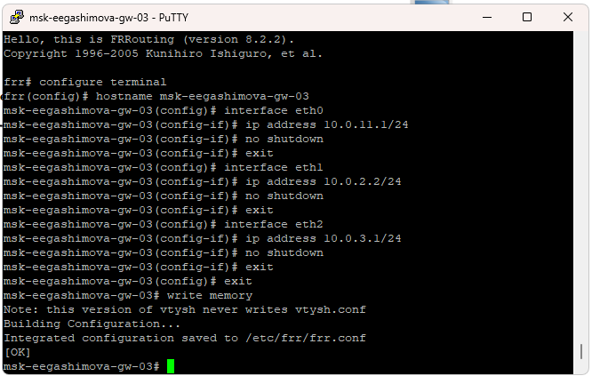{ #fig-006 width=75% }

#### Настройка IPv4-адресов маршрутизатора gw-04

На последнем маршрутизаторе назначаю IPv4-адреса интерфейсам, соединяющим его с `gw-03` и `gw-01`:

```text
configure terminal

interface eth0
ip address 10.0.3.2/24
no shutdown
exit

interface eth1
ip address 10.0.4.1/24
no shutdown
exit

exit
write memory
```

Маршрутизатор обеспечивает альтернативный путь между сетями PC1 и PC2. Конфигурация сохраняется без ошибок (см. рис. [@fig-007]).

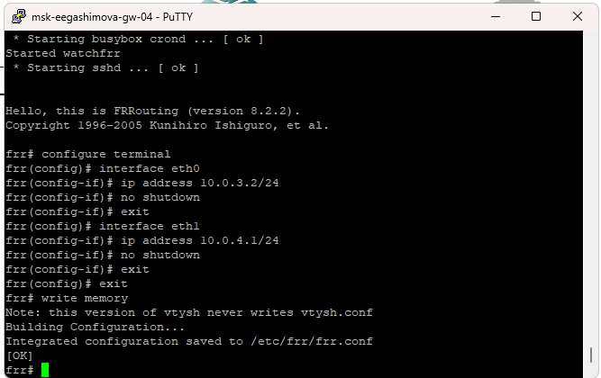{ #fig-007 width=75% }

#### Настройка IPv6-адресов на клиентских устройствах

После конфигурирования IPv4 перехожу к настройке IPv6.

На устройстве `PC1-eegashimova` назначаю глобальный IPv6-адрес `2001:10::a/64`:

```text
ip 2001:10::a/64
save
show ipv6
```

Команда `show ipv6` отображает глобальный адрес `2001:10::a/64` и автоматически сформированный локальный адрес канального уровня, начинающийся с `fe80::` (см. рис. [@fig-008]).

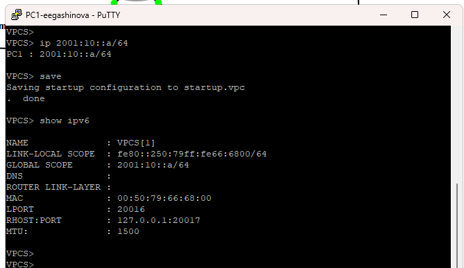{ #fig-008 width=75% }

На клиенте `PC2-eegashimova` выполняю аналогичные действия:

```text
ip 2001:11::a/64
save
show ipv6
```

В результате PC2 получает глобальный IPv6-адрес `2001:11::a/64`. В выводе также присутствует локальный адрес `fe80::`, используемый для взаимодействия в пределах канального сегмента (см. рис. [@fig-009]).

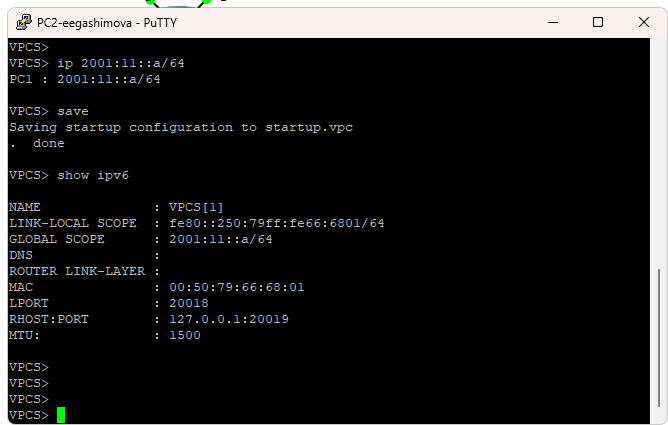{ #fig-009 width=75% }

#### Настройка IPv6 на маршрутизаторе gw-01

На `msk-eegashimova-gw-01` включаю пересылку IPv6-пакетов и назначаю адреса всем используемым интерфейсам.

Для интерфейса `eth0` разрешаю отправку Router Advertisement и объявление префикса локальной сети.

```text
configure terminal
ipv6 forwarding

interface eth0
ipv6 address 2001:10::1/64
no ipv6 nd suppress-ra
ipv6 nd prefix 2001:10::/64
no shutdown
exit

interface eth1
ipv6 address 2001:1::1/64
no shutdown
exit

interface eth2
ipv6 address 2001:4::2/64
no shutdown
exit

exit
write memory
```

Команда `ipv6 forwarding` разрешает маршрутизацию IPv6-трафика. Команды `no ipv6 nd suppress-ra` и `ipv6 nd prefix` обеспечивают распространение информации о маршрутизаторе и сетевом префиксе клиентам локального сегмента (см. рис. [@fig-010]).

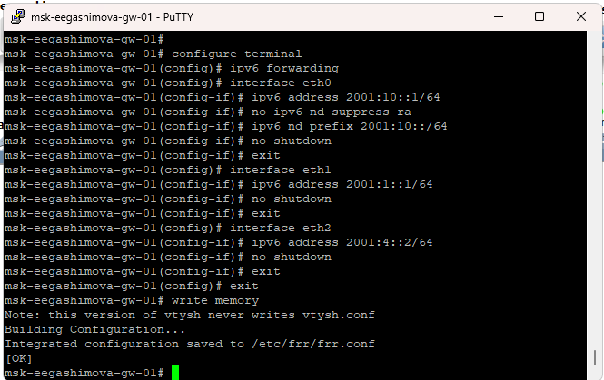{ #fig-010 width=75% }

#### Настройка IPv6 на маршрутизаторе gw-02

На втором маршрутизаторе включаю IPv6-маршрутизацию и назначаю адреса межмаршрутизаторским интерфейсам:

```text
configure terminal
ipv6 forwarding

interface eth0
ipv6 address 2001:1::2/64
no shutdown
exit

interface eth1
ipv6 address 2001:2::1/64
no shutdown
exit

exit
write memory
```

Теперь `gw-02` подключён к IPv6-сетям `2001:1::/64` и `2001:2::/64` (см. рис. [@fig-011]).

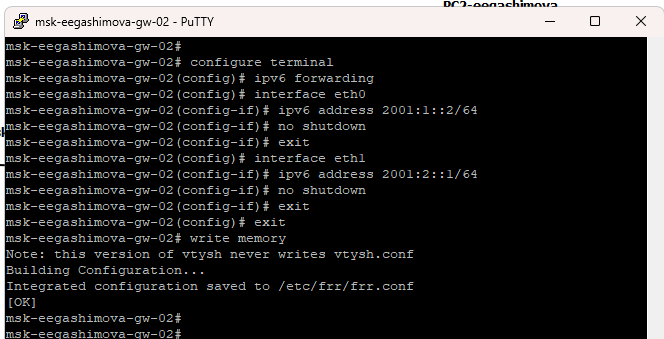{ #fig-011 width=75% }

#### Настройка IPv6 на маршрутизаторе gw-03

На маршрутизаторе `gw-03` настраиваю три интерфейса. Для сети клиента PC2 дополнительно включаю рассылку объявлений маршрутизатора.

```text
configure terminal
ipv6 forwarding

interface eth0
ipv6 address 2001:11::1/64
no ipv6 nd suppress-ra
ipv6 nd prefix 2001:11::/64
no shutdown
exit

interface eth1
ipv6 address 2001:2::2/64
no shutdown
exit

interface eth2
ipv6 address 2001:3::1/64
no shutdown
exit

exit
write memory
```

Интерфейс `eth0` становится шлюзом IPv6 для сети PC2. Остальные интерфейсы обеспечивают связь с маршрутизаторами `gw-02` и `gw-04` (см. рис. [@fig-012]).

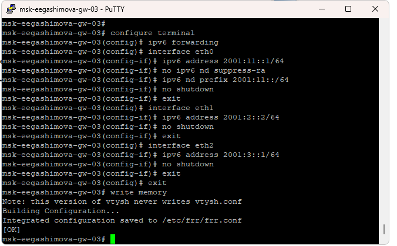{ #fig-012 width=75% }

#### Настройка IPv6 на маршрутизаторе gw-04

Завершаю настройку двойного стека протоколов на четвёртом маршрутизаторе:

```text
configure terminal
hostname msk-eegashimova-gw-04
ipv6 forwarding

interface eth0
ipv6 address 2001:3::2/64
no shutdown
exit

interface eth1
ipv6 address 2001:4::1/64
no shutdown
exit

exit
write memory
```

Маршрутизатор получает доступ к сетям `2001:3::/64` и `2001:4::/64`.

После сохранения настроек все четыре маршрутизатора имеют интерфейсы IPv4 и IPv6, необходимые для дальнейшей настройки динамической маршрутизации (см. рис. [@fig-013]).

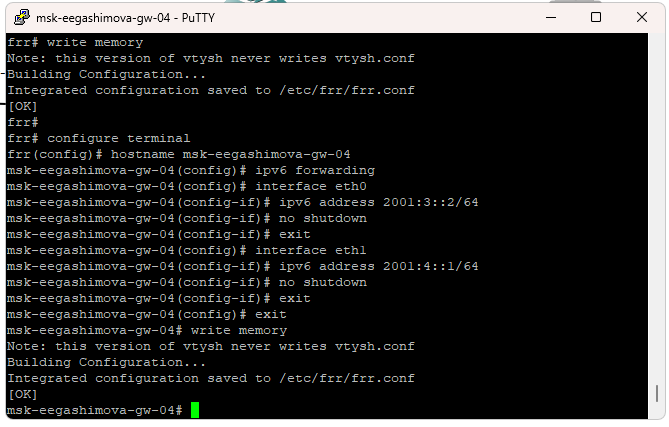{ #fig-013 width=75% }

#### Настройка протокола RIPv2 на маршрутизаторе gw-01

Перехожу к настройке динамической маршрутизации IPv4.

На маршрутизаторе `gw-01` активирую RIP версии 2 и включаю в процесс маршрутизации все три интерфейса:

```text
configure terminal
router rip
version 2
network eth0
network eth1
network eth2
exit
exit
write memory
```

RIPv2 позволяет маршрутизаторам обмениваться информацией о доступных IPv4-сетях, используя в качестве метрики количество переходов между маршрутизаторами.

После применения конфигурации маршрутизатор начинает участвовать в обмене маршрутной информацией (см. рис. [@fig-014]).

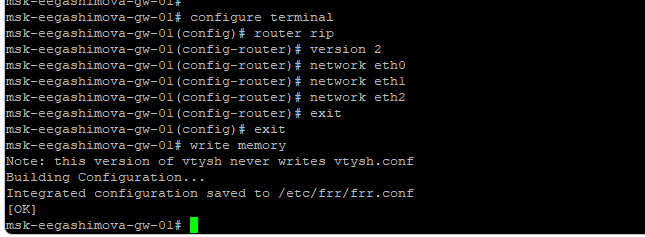{ #fig-014 width=75% }

#### Настройка RIPv2 на маршрутизаторе gw-02

На втором маршрутизаторе включаю RIPv2 для интерфейсов `eth0` и `eth1`:

```text
configure terminal
router rip
version 2
network eth0
network eth1
exit
exit
write memory
```

Оба интерфейса включаются в процесс обмена маршрутной информацией. Конфигурация сохраняется успешно (см. рис. [@fig-015]).

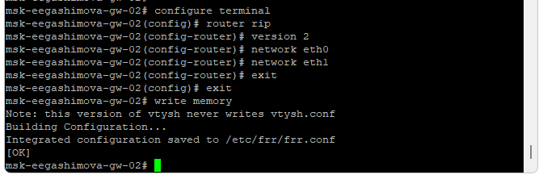{ #fig-015 width=75% }

#### Настройка RIPv2 на маршрутизаторе gw-03

Аналогично настраиваю протокол маршрутизации на `gw-03`:

```text
configure terminal
router rip
version 2
network eth0
network eth1
network eth2
exit
exit
write memory
```

Маршрутизатор начинает распространять информацию о своих подключённых сетях и получать маршруты от соседних устройств (см. рис. [@fig-016]).

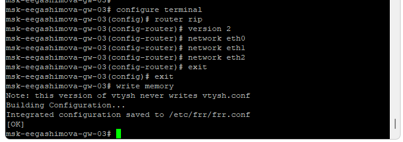{ #fig-016 width=75% }

#### Настройка RIPv2 на маршрутизаторе gw-04

На последнем маршрутизаторе активирую RIPv2 на двух интерфейсах:

```text
configure terminal
router rip
version 2
network eth0
network eth1
exit
exit
write memory
```

Теперь все маршрутизаторы участвуют в динамической маршрутизации, а кольцевая топология позволяет использовать альтернативные маршруты при отказе одного из соединений (см. рис. [@fig-017]).

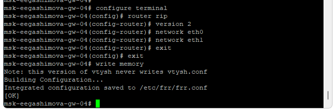{ #fig-017 width=75% }

#### Проверка таблиц маршрутизации RIPv2

После настройки протокола проверяю полученные маршруты на каждом устройстве.

На `gw-01` выполняю команды:

```text
show ip route rip
show ip rip
show ip rip status
```

В таблице маршрутизации появляются записи с обозначением `R`, указывающим на получение маршрута по протоколу RIP.

Маршрутизатор обнаруживает удалённую сеть `10.0.11.0/24` через следующий узел `10.0.1.2` с метрикой 3.

Команда `show ip rip status` подтверждает использование RIP версии 2, периодическую отправку обновлений каждые 30 секунд и административную дистанцию 120 (см. рис. [@fig-018]).

{ #fig-018 width=75% }

На `gw-02` проверяю полученные маршруты:

```text
show ip route rip
show ip rip
show ip rip status
```

В таблице отображаются маршруты к удалённым подсетям, полученные от соседних маршрутизаторов `10.0.1.1` и `10.0.2.2`.

Например, сеть `10.0.10.0/24` доступна через `10.0.1.1`, а сеть `10.0.11.0/24` — через `10.0.2.2`, с метрикой 2 (см. рис. [@fig-019]).

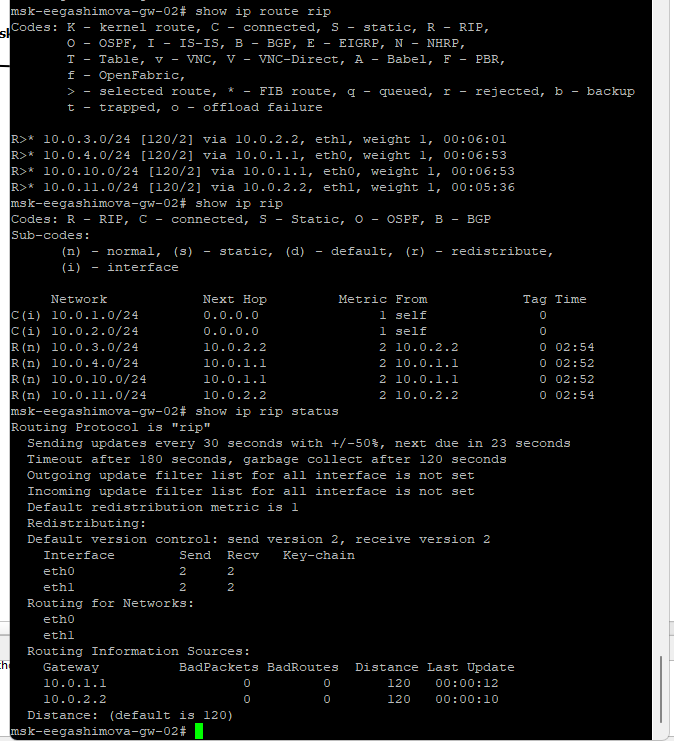{ #fig-019 width=75% }

На маршрутизаторе `gw-03` выполняю аналогичную проверку:

```text
show ip route rip
show ip rip
show ip rip status
```

Маршрутизатор получает сведения о сети `10.0.10.0/24` через `10.0.2.1` с метрикой 3.

В таблице также присутствуют маршруты к промежуточным сетям `10.0.1.0/24` и `10.0.4.0/24` (см. рис. [@fig-020]).

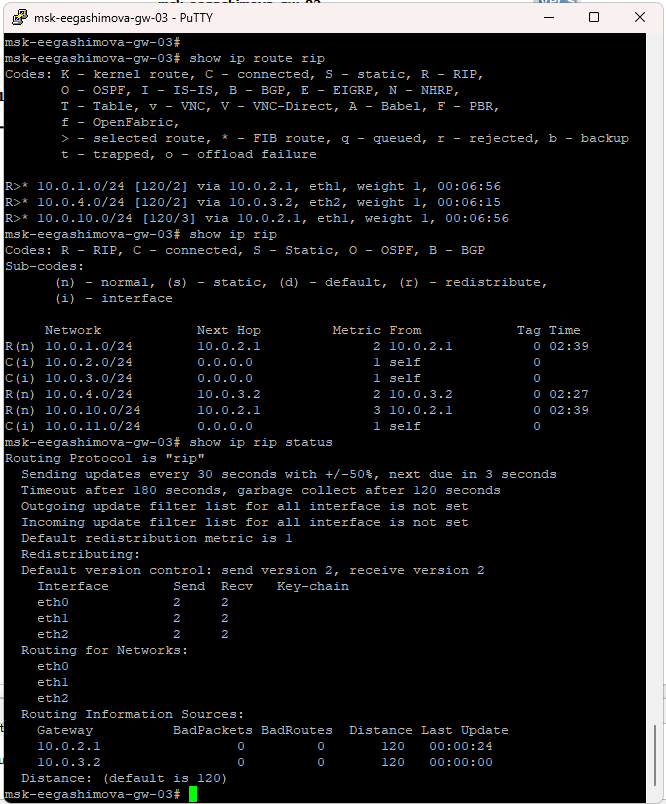{ #fig-020 width=75% }

На `gw-04` проверяю таблицу маршрутизации:

```text
show ip route rip
show ip rip
show ip rip status
```

В выводе присутствуют маршруты к удалённым сетям через соседние маршрутизаторы `10.0.3.1` и `10.0.4.2`.

Полученные записи подтверждают обмен маршрутной информацией между всеми участниками сети (см. рис. [@fig-021]).

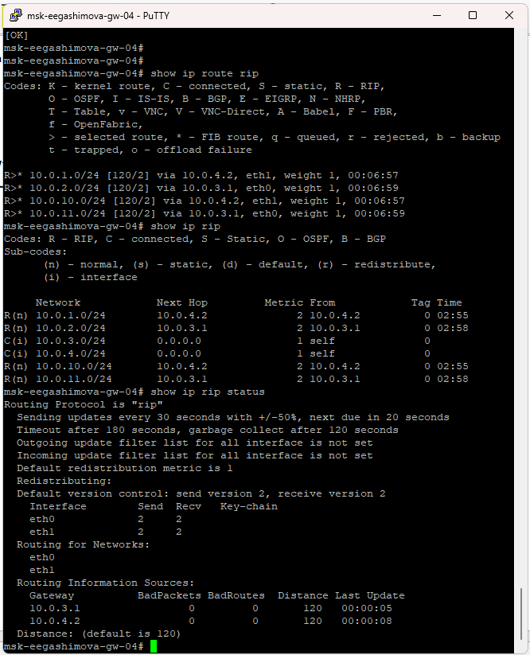{ #fig-021 width=75% }

#### Проверка IPv4-связности и определение маршрута

На клиенте `PC1-eegashimova` проверяю доступность второго клиента:

```text
ping 10.0.11.10
trace 10.0.11.10 -P 6
```

Все пять ICMP-запросов получают ответы от `10.0.11.10`.

Трассировка показывает следующий путь:

```text
1  10.0.10.1
2  10.0.1.2
3  10.0.2.2
4  10.0.11.10
```

Пакеты проходят через маршрутизаторы `gw-01`, `gw-02` и `gw-03`, после чего достигают PC2. Полученные результаты подтверждают работоспособность динамической маршрутизации IPv4 (см. рис. [@fig-022]).

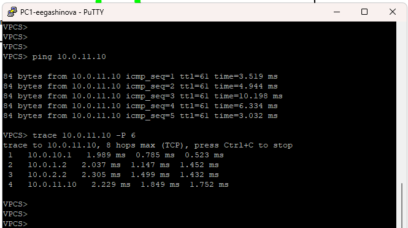{ #fig-022 width=75% }

Дополнительно на `gw-01` просматриваю метрики маршрутов:

```text
show ip rip
```

Сеть `10.0.11.0/24` доступна через `10.0.1.2` с метрикой 3. Это соответствует выбранному маршруту через `gw-02` и `gw-03` (см. рис. [@fig-023]).

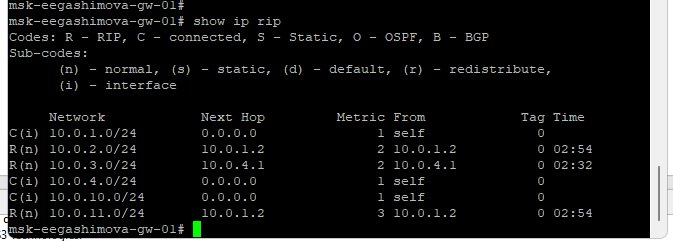{ #fig-023 width=75% }

#### Исследование изменения маршрута при отключении интерфейса

Для проверки реакции протокола RIP на изменение состояния сети отключаю интерфейс `eth0` маршрутизатора `gw-02`:

```text
configure terminal
interface eth0
shutdown
exit
exit
write memory
```

В результате нарушается соединение между `gw-01` и `gw-02`. Поскольку топология содержит альтернативный путь, маршрутизаторы могут использовать направление через `gw-04` (см. рис. [@fig-024]).

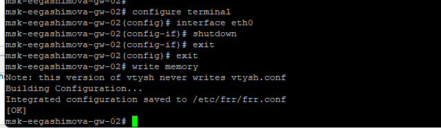{ #fig-024 width=75% }

После изменения топологии проверяю маршруты на `gw-01`:

```text
show ip rip
show ip route rip
show ip rip status
```

Теперь удалённая сеть `10.0.11.0/24` доступна через следующий узел `10.0.4.1` с метрикой 3.

Маршрут проходит через `gw-04` вместо `gw-02`. В выводе `show ip rip status` в качестве источника маршрутной информации отображается `10.0.4.1` (см. рис. [@fig-025]).

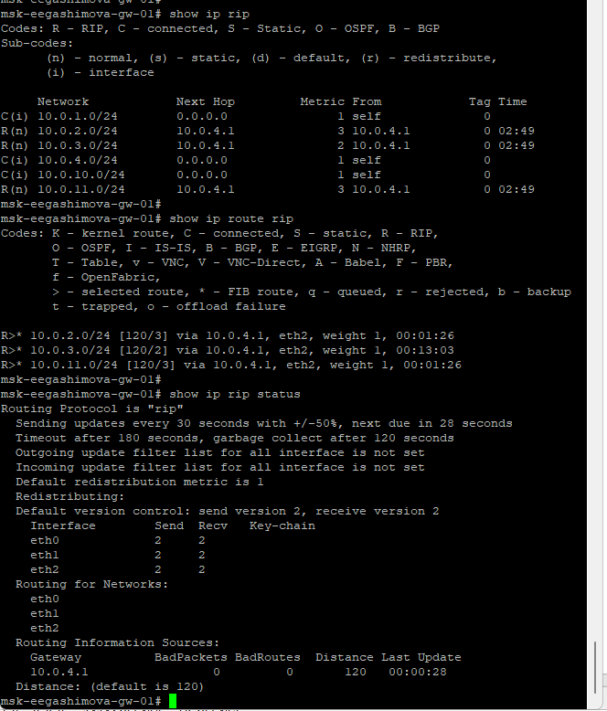{ #fig-025 width=75% }

Повторяю проверку связи с клиентом PC2:

```text
ping 10.0.11.10
trace 10.0.11.10 -P 6
```

Все ICMP-запросы завершаются успешно.

Трассировка показывает новый путь:

```text
1  10.0.10.1
2  10.0.4.1
3  10.0.3.1
4  10.0.11.10
```

Пакеты проходят через `gw-01`, `gw-04` и `gw-03`. Это подтверждает переключение на резервный маршрут без необходимости ручного добавления статических записей (см. рис. [@fig-026]).

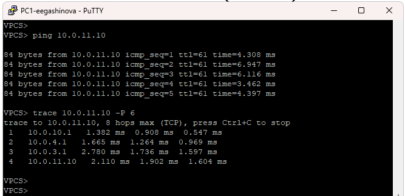{ #fig-026 width=75% }

#### Восстановление соединения и повторная проверка

Возвращаю интерфейс `eth0` маршрутизатора `gw-02` в рабочее состояние:

```text
configure terminal
interface eth0
no shutdown
exit
exit
write memory
```

Соединение между `gw-01` и `gw-02` восстанавливается (см. рис. [@fig-027]).

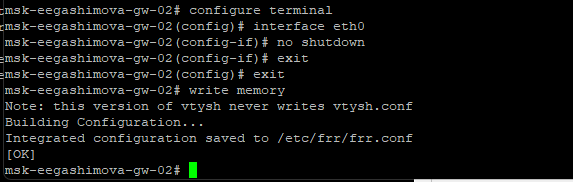{ #fig-027 width=75% }

После восстановления соединения просматриваю маршруты на `gw-01`:

```text
show ip rip
```

В таблице снова появляется информация о маршрутах через `10.0.1.2`, однако сеть `10.0.11.0/24` продолжает использовать маршрут через `10.0.4.1`.

Это связано с тем, что оба направления обеспечивают одинаковую метрику до конечной подсети. RIP не обязан немедленно возвращаться к первоначальному маршруту при наличии равнозначного рабочего пути (см. рис. [@fig-028]).

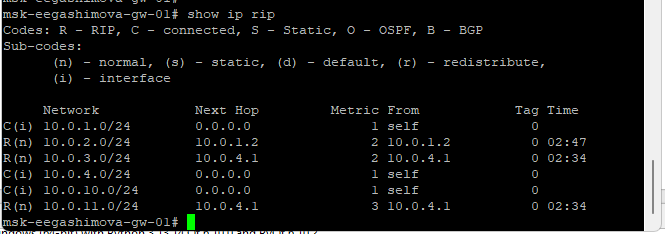{ #fig-028 width=75% }

Повторно выполняю:

```text
ping 10.0.11.10
trace 10.0.11.10 -P 6
```

Все пять ICMP-запросов проходят успешно. Трассировка по-прежнему показывает направление через `10.0.4.1` и `10.0.3.1`.

Следовательно, восстановление интерфейса не приводит к нарушению связи. Точное время перестроения маршрута по представленным снимкам экрана определить нельзя, однако результат повторных проверок подтверждает успешную адаптацию маршрутизации к изменению топологии (см. рис. [@fig-029]).

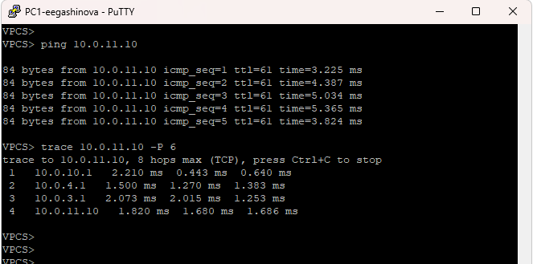{ #fig-029 width=75% }

#### Анализ трафика RIPv2 в Wireshark

Открываю захваченный трафик в Wireshark и исследую сообщения протокола RIPv2.

В списке пакетов наблюдаю сообщения RIP, ICMP-запросы и ответы, а также TCP-пакеты, связанные с трассировкой.

В одном из пакетов RIPv2 отображаются следующие параметры:

- IP-адрес источника — `10.0.10.1`;
- адрес назначения — `224.0.0.9`;
- транспортный протокол — UDP;
- порт источника и назначения — `520`;
- команда RIP — `Response (2)`;
- версия протокола — `RIPv2 (2)`.

Внутри сообщения передаются сведения об IPv4-подсетях и соответствующих метриках.

Например, пакет содержит маршруты к сетям `10.0.1.0/24`, `10.0.2.0/24`, `10.0.3.0/24`, `10.0.4.0/24` и `10.0.11.0/24`. Для них указываются маски, метрики и поля следующего перехода (см. рис. [@fig-030]).

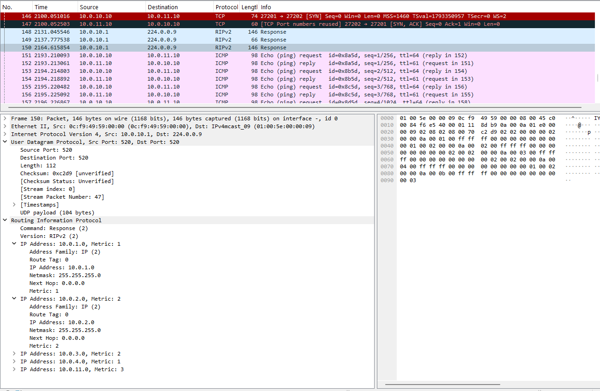{ #fig-030 width=85% }

Анализирую другой захваченный пакет с сообщением RIP Response.

В его структуре также присутствуют поля `IP Address`, `Netmask`, `Next Hop` и `Metric`.

По этим данным можно определить, какие подсети маршрутизатор объявляет соседним устройствам и сколько переходов требуется для достижения каждой из них.

Наличие периодических сообщений подтверждает функционирование протокола динамической маршрутизации (см. рис. [@fig-031]).

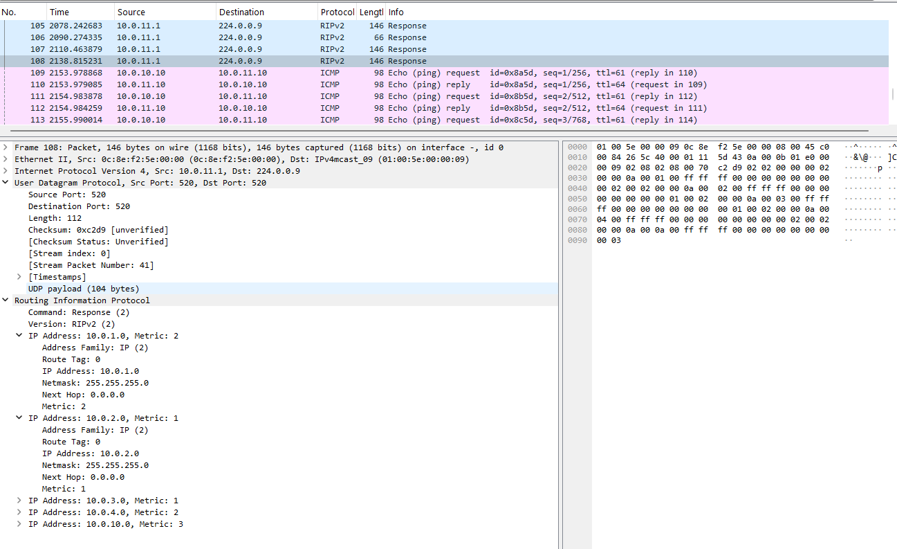{ #fig-031 width=85% }

#### Настройка динамической маршрутизации IPv6 по RIPng

После проверки RIPv2 перехожу к настройке протокола RIPng, предназначенного для обмена маршрутной информацией в IPv6-сетях.

На маршрутизаторе `gw-01` активирую RIPng для всех используемых интерфейсов:

```text
configure terminal
router ripng
network eth0
network eth1
network eth2
exit
exit
write memory
```

Протокол RIPng начинает участвовать в обмене информацией о доступных IPv6-префиксах (см. рис. [@fig-032]).

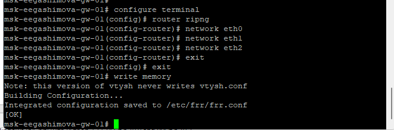{ #fig-032 width=75% }

На маршрутизаторе `gw-02` включаю RIPng на двух интерфейсах:

```text
configure terminal
router ripng
network eth0
network eth1
exit
exit
write memory
```

Конфигурация сохраняется успешно (см. рис. [@fig-033]).

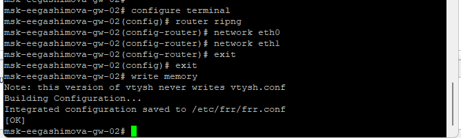{ #fig-033 width=75% }

На `gw-03` добавляю в процесс RIPng интерфейсы `eth0`, `eth1` и `eth2`:

```text
configure terminal
router ripng
network eth0
network eth1
network eth2
exit
exit
write memory
```

Теперь маршрутизатор может передавать сведения о локальной IPv6-сети PC2 соседним маршрутизаторам (см. рис. [@fig-034]).

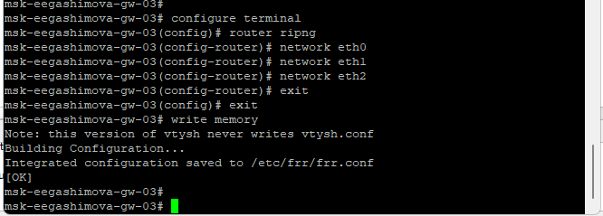{ #fig-034 width=75% }

На `gw-04` выполняю настройку:

```text
configure terminal
router ripng
network eth0
network eth1
exit
exit
write memory
```

После сохранения конфигурации все четыре маршрутизатора участвуют в динамической маршрутизации IPv6 (см. рис. [@fig-035]).

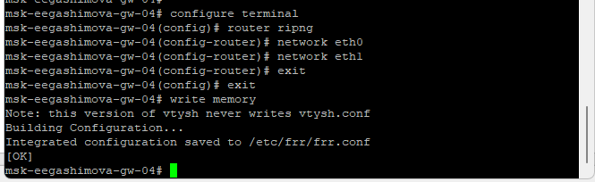{ #fig-035 width=75% }

#### Проверка IPv6-связности и маршрутов RIPng

На клиенте PC1 проверяю доступность IPv6-адреса второго клиента:

```text
ping 2001:11::a
trace 2001:11::a
```

Получаю ответы на все пять ICMPv6-запросов.

Трассировка показывает следующий путь:

```text
1  2001:10::1
2  2001:1::2
3  2001:2::2
4  2001:11::a
```

Пакеты проходят через `gw-01`, `gw-02` и `gw-03`, после чего достигают PC2.

Результат подтверждает работоспособность маршрутизации IPv6 между удалёнными сегментами сети (см. рис. [@fig-036]).

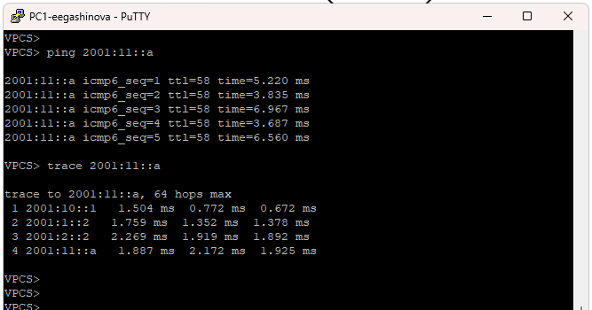{ #fig-036 width=75% }

На маршрутизаторе `gw-01` проверяю таблицу маршрутов RIPng:

```text
show ipv6 ripng
```

В таблице отображаются непосредственно подключённые сети с обозначением `C(i)` и маршруты RIPng с обозначением `R(n)`.

Удалённая сеть `2001:11::/64` доступна через интерфейс `eth1` с метрикой 3.

В качестве следующего перехода используется локальный IPv6-адрес соседнего маршрутизатора из диапазона `fe80::/10`. Это является особенностью маршрутизации IPv6, при которой в качестве адресов соседних маршрутизаторов часто используются link-local адреса (см. рис. [@fig-037]).

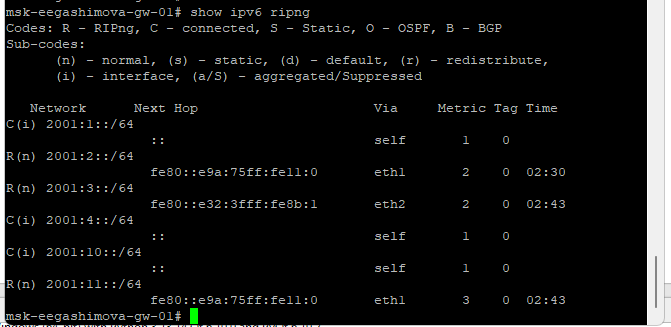{ #fig-037 width=75% }

#### Проверка перестроения маршрутов RIPng

Для исследования отказоустойчивости IPv6-маршрутизации отключаю интерфейс `eth0` маршрутизатора `gw-02`:

```text
configure terminal
interface eth0
shutdown
exit
exit
write memory
```

В результате становится недоступным непосредственное соединение `gw-01` с `gw-02` (см. рис. [@fig-038]).

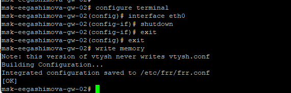{ #fig-038 width=75% }

После изменения состояния сети на `gw-01` проверяю таблицу RIPng:

```text
show ipv6 ripng
```

В выводе наблюдаю изменение следующего перехода для удалённых сетей.

Маршруты к `2001:2::/64`, `2001:3::/64` и `2001:11::/64` теперь проходят через интерфейс `eth2`, подключённый к `gw-04`.

Метрика до сети `2001:11::/64` остаётся равной 3, поскольку альтернативный путь содержит такое же количество маршрутизаторов (см. рис. [@fig-039]).

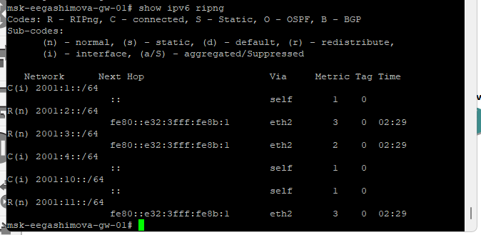{ #fig-039 width=75% }

На PC1 повторяю проверку:

```text
ping 2001:11::a
trace 2001:11::a
```

Все ICMPv6-запросы получают ответы.

Трассировка показывает новый маршрут:

```text
1  2001:10::1
2  2001:4::1
3  2001:3::1
4  2001:11::a
```

Теперь трафик проходит через `gw-01`, `gw-04` и `gw-03`.

Полученные результаты подтверждают переключение RIPng на доступное альтернативное направление (см. рис. [@fig-040]).

{ #fig-040 width=75% }

#### Восстановление интерфейса и повторная проверка RIPng

Восстанавливаю интерфейс `eth0` маршрутизатора `gw-02`:

```text
configure terminal
interface eth0
no shutdown
exit
exit
write memory
```

После выполнения команды `no shutdown` соединение снова становится доступным (см. рис. [@fig-041]).

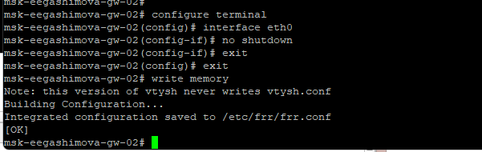{ #fig-041 width=75% }

На `gw-01` выполняю:

```text
show ipv6 ripng
```

В таблице снова присутствуют маршруты, полученные через `eth1`, в том числе маршрут к сети `2001:2::/64`.

При этом маршрут к клиентской сети `2001:11::/64` продолжает использовать интерфейс `eth2` и альтернативное направление через `gw-04`.

Это подтверждает, что восстановление соединения не требует обязательного немедленного переключения на первоначальный путь при равных метриках (см. рис. [@fig-042]).

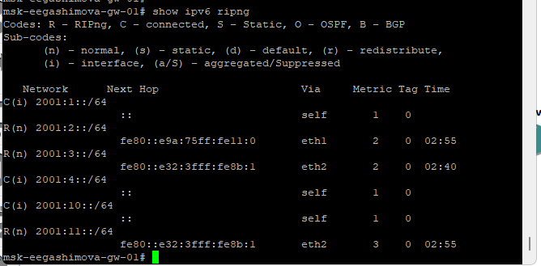{ #fig-042 width=75% }

На PC1 снова выполняю:

```text
ping 2001:11::a
trace 2001:11::a
```

Все пять ICMPv6-запросов завершаются успешно.

Трассировка по-прежнему показывает маршрут через `2001:4::1` и `2001:3::1`.

Следовательно, восстановленная топология обеспечивает связь между клиентами, а RIPng сохраняет работоспособный маршрут (см. рис. [@fig-043]).

{ #fig-043 width=75% }

#### Анализ трафика RIPng в Wireshark

Открываю захваченный трафик и исследую сообщения RIPng.

В Wireshark наблюдаю пакеты RIPv2, RIPng и ICMPv6 Router Advertisement.

Для RIPng определяю следующие характеристики:

- транспортный протокол — UDP;
- порт источника и назначения — `521`;
- многоадресный IPv6-адрес назначения — `ff02::9`;
- IPv6-адрес источника — локальный адрес маршрутизатора `fe80::`;
- команда — `Response (2)`;
- версия RIPng — `1`.

Внутри пакета присутствуют записи о маршрутах, содержащие IPv6-префиксы, длину префикса и метрику.

Например, отображаются сети `2001:1::/64`, `2001:2::/64`, `2001:3::/64`, `2001:4::/64`, `2001:10::/64` и `2001:11::/64` с различными метриками (см. рис. [@fig-044]).

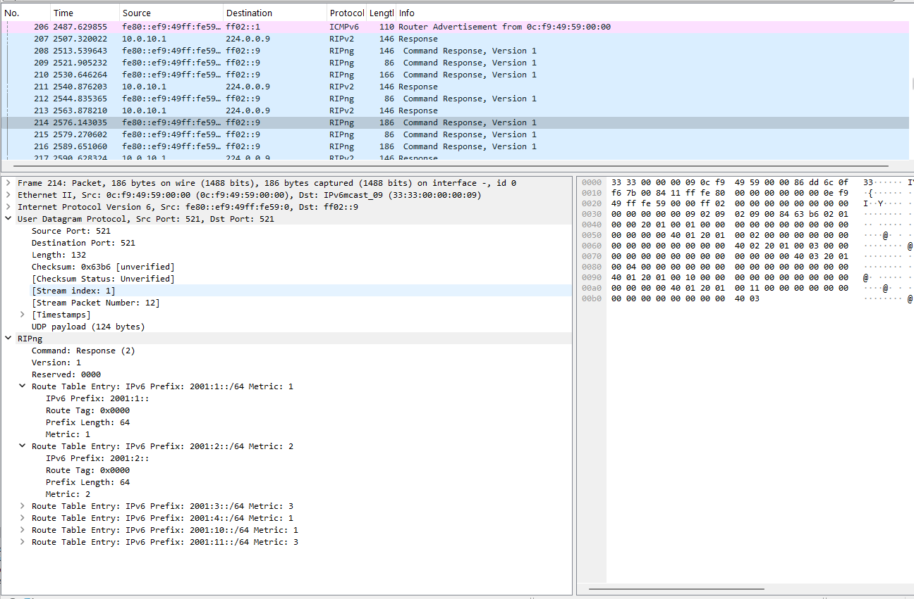{ #fig-044 width=85% }

В другом захваченном пакете анализирую содержимое маршрутного обновления RIPng.

В сообщении передаются IPv6-префиксы с длиной 64 бита и значениями метрик от 1 до 3.

Например, для сети `2001:2::/64` указана метрика 1, а для сети `2001:4::/64` — метрика 3.

По этим данным можно определить представление маршрутизатора о стоимости достижения удалённых сетей.

В отличие от RIPv2, использующего адрес `224.0.0.9` и UDP-порт `520`, RIPng передаёт обновления на `ff02::9` через UDP-порт `521` (см. рис. [@fig-045]).

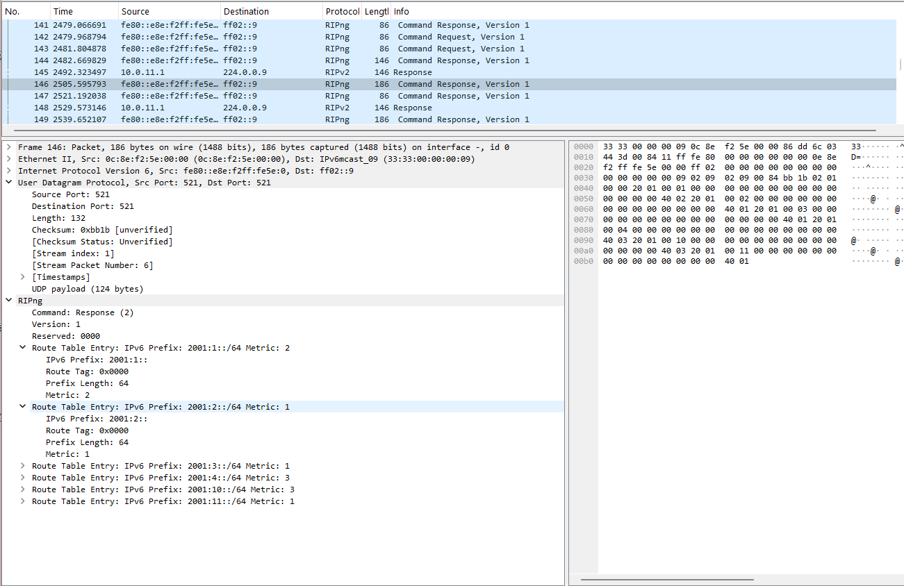{ #fig-045 width=85% }

### Самостоятельное задание. Настройка RIP в сети с изменённой адресацией

#### Документирование сети самостоятельного задания

Для самостоятельного задания использую топологию с четырьмя маршрутизаторами, двумя коммутаторами и двумя клиентскими устройствами.

В отличие от предыдущей сети, клиент PC1 подключён к `gw-01`, а PC2 — к `gw-02`. Между маршрутизаторами доступны два пути: через `gw-03` и через `gw-04`.

Разрабатываю схему L1 с обозначением сетевых интерфейсов (см. рис. [@fig-l1-task]).

{ #fig-l1-task width=85% }

Для IPv4 использую адресное пространство `10.10.1.0/24`, разделённое на подсети разной длины. Для IPv6 использую префиксы из диапазона `2001:db8:1::/48`.

Распределение сетевых адресов:

| Соединение | Сеть IPv4 | Сеть IPv6 |
|---|---|---|
| PC1 — gw-01 | 10.10.1.96/27 | 2001:db8:1:1::/64 |
| PC2 — gw-02 | 10.10.1.64/28 | 2001:db8:1:6::/64 |
| gw-01 — gw-03 | 10.10.1.4/30 | 2001:db8:1:2::/64 |
| gw-01 — gw-04 | 10.10.1.8/30 | 2001:db8:1:3::/64 |
| gw-03 — gw-02 | 10.10.1.16/30 | 2001:db8:1:4::/64 |
| gw-04 — gw-02 | 10.10.1.32/30 | 2001:db8:1:5::/64 |

Создаю схему L3, на которой отображаю выделенные подсети и соответствующие соединения (см. рис. [@fig-l3-task]).

{ #fig-l3-task width=85% }

Составляю таблицу адресов интерфейсов:

| Устройство | Интерфейс | IPv4-адрес | IPv6-адрес |
|---|---|---|---|
| gw-01 | eth0 | 10.10.1.97/27 | 2001:db8:1:1::1/64 |
| gw-01 | eth1 | 10.10.1.5/30 | 2001:db8:1:2::1/64 |
| gw-01 | eth2 | 10.10.1.9/30 | 2001:db8:1:3::1/64 |
| gw-02 | eth0 | 10.10.1.65/28 | 2001:db8:1:6::1/64 |
| gw-02 | eth1 | 10.10.1.18/30 | 2001:db8:1:4::2/64 |
| gw-02 | eth2 | 10.10.1.34/30 | 2001:db8:1:5::2/64 |
| gw-03 | eth0 | 10.10.1.6/30 | 2001:db8:1:2::2/64 |
| gw-03 | eth1 | 10.10.1.17/30 | 2001:db8:1:4::1/64 |
| gw-04 | eth0 | 10.10.1.10/30 | 2001:db8:1:3::2/64 |
| gw-04 | eth1 | 10.10.1.33/30 | 2001:db8:1:5::1/64 |
| PC1 | NIC | 10.10.1.98/27 | 2001:db8:1:1::a/64 |
| PC2 | NIC | 10.10.1.66/28 | 2001:db8:1:6::a/64 |

Для клиента PC1 задаю шлюз IPv4 `10.10.1.97`, а для PC2 — `10.10.1.65`.

#### Построение топологии самостоятельного задания

В GNS3 собираю новую топологию. Сохраняю имена маршрутизаторов и клиентских устройств с учётной записью `eegashimova`.

Маршрутизатор `gw-01` соединяю с `gw-03` и `gw-04`, которые подключаются к `gw-02`. Оконечные устройства подключаю через коммутаторы Ethernet.

Такая структура содержит два альтернативных пути между клиентскими сетями и позволяет исследовать динамическую маршрутизацию с использованием подсетей разной длины (см. рис. [@fig-046]).

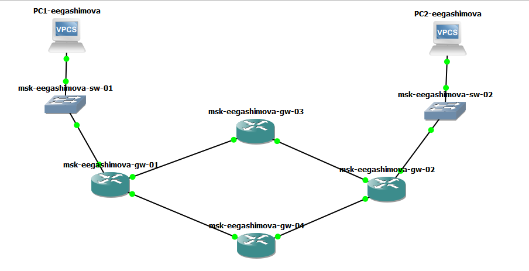{ #fig-046 width=85% }

#### Настройка маршрутизатора gw-01 в самостоятельном задании

На маршрутизаторе `msk-eegashimova-gw-01` настраиваю адреса IPv4 и IPv6, разрешаю пересылку IPv6-пакетов и включаю протоколы RIPv2 и RIPng.

```text
configure terminal
hostname msk-eegashimova-gw-01
ipv6 forwarding

interface eth0
ip address 10.10.1.97/27
ipv6 address 2001:db8:1:1::1/64
no ipv6 nd suppress-ra
ipv6 nd prefix 2001:db8:1:1::/64
no shutdown
exit

interface eth1
ip address 10.10.1.5/30
ipv6 address 2001:db8:1:2::1/64
no shutdown
exit

interface eth2
ip address 10.10.1.9/30
ipv6 address 2001:db8:1:3::1/64
no shutdown
exit

router rip
version 2
network eth0
network eth1
network eth2
exit

router ripng
network eth0
network eth1
network eth2
exit

exit
write memory
```

Для локальной сети PC1 включаю распространение IPv6-префикса через Router Advertisement.

После применения конфигурации маршрутизатор обслуживает клиентскую сеть и два межмаршрутизаторских соединения (см. рис. [@fig-047]).

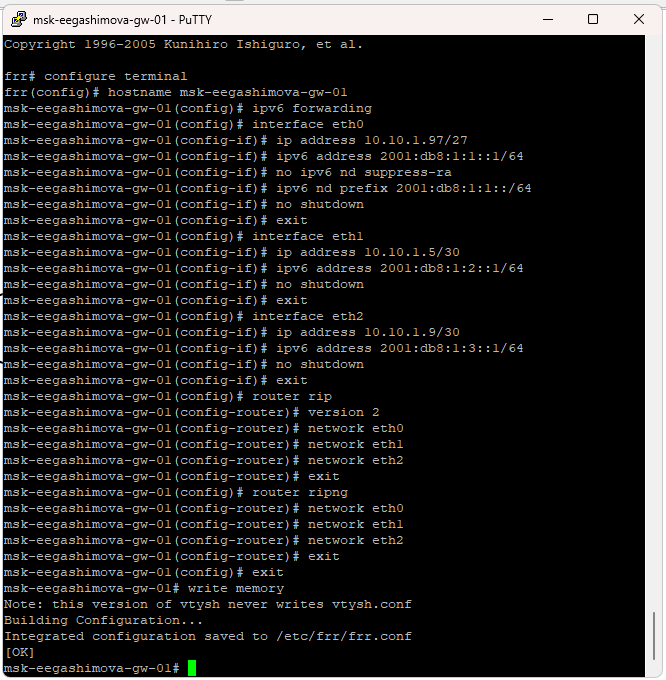{ #fig-047 width=75% }

#### Настройка маршрутизатора gw-02 в самостоятельном задании

На втором маршрутизаторе настраиваю три интерфейса и оба протокола динамической маршрутизации:

```text
configure terminal
hostname msk-eegashimova-gw-02
ipv6 forwarding

interface eth0
ip address 10.10.1.65/28
ipv6 address 2001:db8:1:6::1/64
no ipv6 nd suppress-ra
ipv6 nd prefix 2001:db8:1:6::/64
no shutdown
exit

interface eth1
ip address 10.10.1.18/30
ipv6 address 2001:db8:1:4::2/64
no shutdown
exit

interface eth2
ip address 10.10.1.34/30
ipv6 address 2001:db8:1:5::2/64
no shutdown
exit

router rip
version 2
network eth0
network eth1
network eth2
exit

router ripng
network eth0
network eth1
network eth2
exit

exit
write memory
```

При настройке `eth1` исправляю первоначально введённую длину IPv4-префикса `/3` на `/30`. Итоговый адрес интерфейса — `10.10.1.18/30`.

Маршрутизатор становится шлюзом для клиентской сети PC2 и участвует в обмене маршрутами через два соседних устройства (см. рис. [@fig-048]).

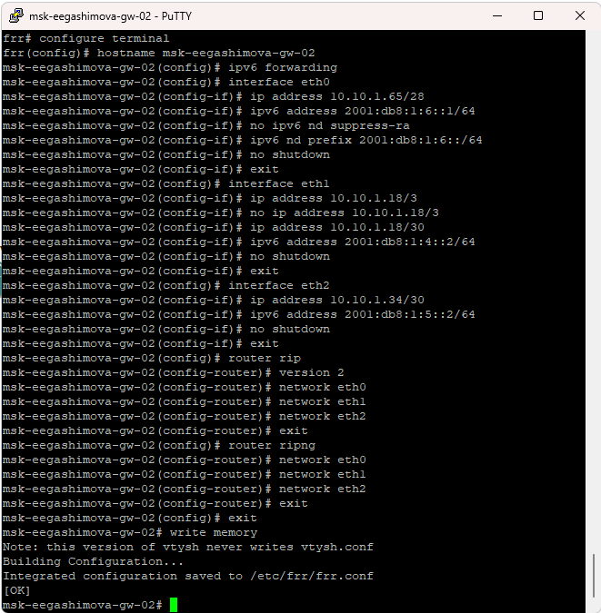{ #fig-048 width=75% }

#### Настройка маршрутизатора gw-03 в самостоятельном задании

На маршрутизаторе `gw-03` настраиваю соединение между `gw-01` и `gw-02`:

```text
configure terminal
hostname msk-eegashimova-gw-03
ipv6 forwarding

interface eth0
ip address 10.10.1.6/30
ipv6 address 2001:db8:1:2::2/64
no shutdown
exit

interface eth1
ip address 10.10.1.17/30
ipv6 address 2001:db8:1:4::1/64
no shutdown
exit

router rip
version 2
network eth0
network eth1
exit

router ripng
network eth0
network eth1
exit

exit
write memory
```

После сохранения конфигурации маршрутизатор начинает распространять маршрутную информацию между верхними сегментами сети (см. рис. [@fig-049]).

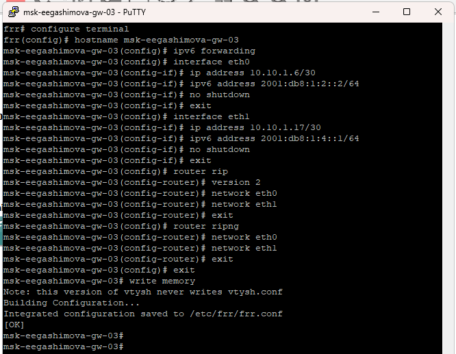{ #fig-049 width=75% }

#### Настройка маршрутизатора gw-04 в самостоятельном задании

На последнем маршрутизаторе настраиваю альтернативное направление между `gw-01` и `gw-02`:

```text
configure terminal
hostname msk-eegashimova-gw-04
ipv6 forwarding

interface eth0
ip address 10.10.1.10/30
ipv6 address 2001:db8:1:3::2/64
no shutdown
exit

interface eth1
ip address 10.10.1.33/30
ipv6 address 2001:db8:1:5::1/64
no shutdown
exit

router rip
version 2
network eth0
network eth1
exit

router ripng
network eth0
network eth1
exit

exit
write memory
```

Таким образом, все маршрутизаторы самостоятельного задания получают адреса двойного стека и участвуют в обмене маршрутной информацией RIPv2 и RIPng (см. рис. [@fig-050]).

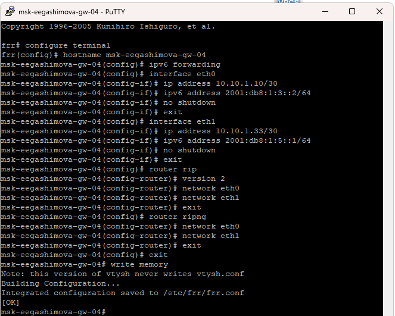{ #fig-050 width=75% }

#### Настройка клиентских устройств в самостоятельном задании

На PC1 назначаю IPv4-адрес `10.10.1.98/27`, шлюз `10.10.1.97` и IPv6-адрес `2001:db8:1:1::a/64`:

```text
ip 10.10.1.98/27 10.10.1.97
ip 2001:db8:1:1::a/64
save
```

После выполнения команд конфигурация сохраняется в `startup.vpc` (см. рис. [@fig-051]).

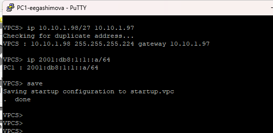{ #fig-051 width=75% }

На PC2 задаю параметры второй локальной сети:

```text
ip 10.10.1.66/28 10.10.1.65
ip 2001:db8:1:6::a/64
save
```

Теперь PC2 использует IPv4-адрес `10.10.1.66/28`, шлюз `10.10.1.65` и IPv6-адрес `2001:db8:1:6::a/64` (см. рис. [@fig-052]).

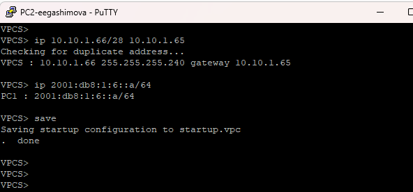{ #fig-052 width=75% }

#### Проверка маршрутов RIPv2 и RIPng на gw-01

После настройки всех устройств проверяю динамические маршруты на `gw-01`:

```text
show ip rip
show ipv6 ripng
```

В таблице IPv4 отображаются подключённые сети `10.10.1.96/27`, `10.10.1.4/30` и `10.10.1.8/30`, а также маршруты к удалённым подсетям.

Клиентская сеть PC2 `10.10.1.64/28` доступна через маршрутизатор `10.10.1.6` с метрикой 3.

В таблице RIPng также присутствуют удалённые IPv6-префиксы. Сеть `2001:db8:1:6::/64` достигается через интерфейс `eth1` с метрикой 3 (см. рис. [@fig-053]).

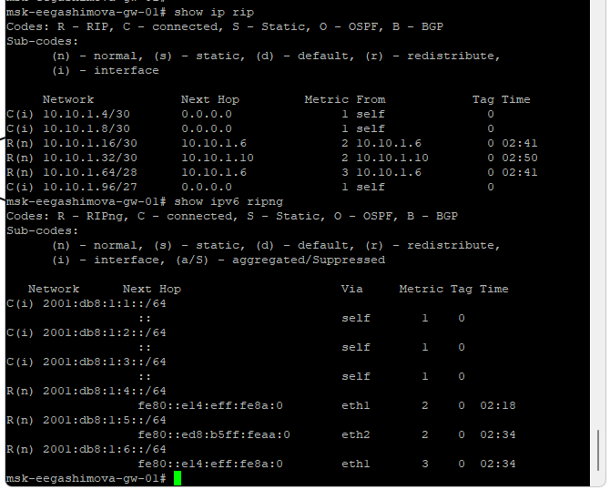{ #fig-053 width=75% }

#### Проверка маршрутов на gw-02

На маршрутизаторе `gw-02` выполняю:

```text
show ip rip
show ipv6 ripng
```

В таблице IPv4 присутствуют маршруты к удалённой клиентской сети `10.10.1.96/27` и промежуточным сегментам.

В RIPng отображаются маршруты к удалённым IPv6-подсетям, в том числе `2001:db8:1:1::/64`, полученные от соседних маршрутизаторов.

Наличие маршрутных записей подтверждает обмен информацией между устройствами (см. рис. [@fig-054]).

{ #fig-054 width=75% }

#### Проверка маршрутов на gw-03

На третьем маршрутизаторе проверяю:

```text
show ip rip
show ipv6 ripng
```

Непосредственно подключёнными являются IPv4-сети `10.10.1.4/30` и `10.10.1.16/30`.

Остальные сети изучаются динамически через соседние маршрутизаторы.

В таблице RIPng присутствуют маршруты к клиентским сетям `2001:db8:1:1::/64` и `2001:db8:1:6::/64`, а также к дополнительным межмаршрутизаторским сегментам (см. рис. [@fig-055]).

{ #fig-055 width=75% }

#### Проверка маршрутов на gw-04

На последнем маршрутизаторе выполняю:

```text
show ip rip
show ipv6 ripng
```

Устройство получает маршруты к удалённым IPv4- и IPv6-сетям через соседние маршрутизаторы `gw-01` и `gw-02`.

В таблице IPv4 видны маршруты к клиентским подсетям `10.10.1.96/27` и `10.10.1.64/28`.

В RIPng присутствуют IPv6-префиксы обеих клиентских сетей и промежуточных соединений (см. рис. [@fig-056]).

{ #fig-056 width=75% }

#### Проверка связности от PC1 к PC2

На устройстве PC1 проверяю доступность второго клиента по IPv4:

```text
ping 10.10.1.66
trace 10.10.1.66 -P 6
```

Все пять ICMP-запросов завершаются успешно.

Трассировка показывает следующий маршрут:

```text
1  10.10.1.97
2  10.10.1.6
3  10.10.1.18
4  10.10.1.66
```

Пакеты проходят через `gw-01`, `gw-03` и `gw-02`.

Затем проверяю IPv6-связность:

```text
ping 2001:db8:1:6::a
trace 2001:db8:1:6::a
```

Получаю ответы на все ICMPv6-запросы.

Путь прохождения пакетов:

```text
1  2001:db8:1:1::1
2  2001:db8:1:2::2
3  2001:db8:1:4::2
4  2001:db8:1:6::a
```

Маршрут IPv6 также проходит через `gw-01`, `gw-03` и `gw-02`.

Результаты подтверждают успешную работу обоих протоколов маршрутизации (см. рис. [@fig-057]).

{ #fig-057 width=75% }

#### Проверка связности от PC2 к PC1

На втором клиенте выполняю проверку обратного направления:

```text
ping 10.10.1.98
trace 10.10.1.98 -P 6
```

Все ICMP-запросы получают ответы.

Трассировка показывает следующий путь:

```text
1  10.10.1.65
2  10.10.1.17
3  10.10.1.5
4  10.10.1.98
```

Пакеты проходят через `gw-02`, `gw-03` и `gw-01`.

Аналогично проверяю IPv6:

```text
ping 2001:db8:1:1::a
trace 2001:db8:1:1::a
```

Получаю ответы на все ICMPv6-запросы.

Трассировка:

```text
1  2001:db8:1:6::1
2  2001:db8:1:4::1
3  2001:db8:1:2::1
4  2001:db8:1:1::a
```

Проверка подтверждает двустороннюю доступность клиентских устройств по IPv4 и IPv6 (см. рис. [@fig-058]).

{ #fig-058 width=75% }

#### Анализ полной таблицы маршрутизации gw-01

Для более подробной проверки выполняю команды:

```text
show ip route
show ipv6 route
```

В таблице IPv4 наблюдаю маршруты двух типов:

- `C` — непосредственно подключённые сети;
- `R` — сети, изученные по протоколу RIP.

Например, сеть `10.10.1.64/28` доступна по RIPv2 через следующий переход `10.10.1.6` с административной дистанцией 120 и метрикой 3.

В таблице IPv6 аналогично отображаются подключённые и динамические маршруты.

Для удалённых IPv6-префиксов в качестве следующих переходов используются локальные адреса соседних маршрутизаторов из диапазона `fe80::/10` (см. рис. [@fig-059]).

{ #fig-059 width=75% }

#### Анализ полной таблицы маршрутизации gw-02

На `gw-02` просматриваю:

```text
show ip route
show ipv6 route
```

В таблице IPv4 присутствуют непосредственно подключённые сети `10.10.1.64/28`, `10.10.1.16/30` и `10.10.1.32/30`.

Удалённая клиентская сеть PC1 `10.10.1.96/27` изучена через RIP.

В таблице IPv6 наблюдаю аналогичную структуру маршрутов. Удалённые префиксы изучены через RIPng, а подключённые сегменты отображаются отдельно.

Это подтверждает согласованную работу маршрутизации IPv4 и IPv6 (см. рис. [@fig-060]).

{ #fig-060 width=75% }

#### Анализ полной таблицы маршрутизации gw-03

На третьем маршрутизаторе выполняю:

```text
show ip route
show ipv6 route
```

В IPv4-таблице непосредственно подключёнными являются сети `10.10.1.4/30` и `10.10.1.16/30`.

Клиентские подсети `10.10.1.96/27` и `10.10.1.64/28` доступны по RIP с метрикой 2.

В IPv6-таблице также присутствуют маршруты к обеим клиентским сетям, изученные по RIPng.

Проверка подтверждает, что промежуточный маршрутизатор корректно передаёт сведения о достижимости удалённых сетей (см. рис. [@fig-061]).

{ #fig-061 width=75% }

#### Анализ полной таблицы маршрутизации gw-04

Завершаю проверку на маршрутизаторе `gw-04`:

```text
show ip route
show ipv6 route
```

В таблице IPv4 отображаются непосредственно подключённые сети `10.10.1.8/30` и `10.10.1.32/30`.

Маршруты к клиентским сетям и другим промежуточным сегментам получены от соседних маршрутизаторов.

В таблице IPv6 также присутствуют маршруты RIPng, необходимые для передачи пакетов между удалёнными IPv6-подсетями.

Полученные результаты подтверждают, что все маршрутизаторы самостоятельного задания имеют необходимую информацию для передачи IPv4- и IPv6-пакетов (см. рис. [@fig-062]).

{ #fig-062 width=75% }

# Вывод

В ходе лабораторной работы была создана и настроена сеть в GNS3 с использованием маршрутизаторов FRRouting, коммутаторов Ethernet и клиентских устройств VPCS. Были разработаны схемы L1 и L3, составлены таблицы адресации и настроены интерфейсы устройств с использованием протоколов IPv4 и IPv6.

На маршрутизаторах была настроена динамическая маршрутизация по протоколам RIPv2 и RIPng. Выполнена проверка таблиц маршрутизации, метрик и доступности удалённых сетей. С помощью команд `ping` и `trace` были проверены соединения между клиентскими устройствами и определены пути прохождения пакетов.

Для исследования отказоустойчивости было выполнено отключение и последующее восстановление сетевого интерфейса одного из маршрутизаторов. Проверено изменение маршрутов и переключение трафика на альтернативный путь. Также был проведён анализ захваченного трафика в Wireshark, изучены маршрутные обновления RIPv2 и RIPng.

В самостоятельном задании была построена сеть с другой схемой адресации, настроены IPv4 и IPv6, а также протоколы динамической маршрутизации. Выполнена проверка связности между клиентами и просмотр таблиц маршрутизации на всех маршрутизаторах.

# Список литературы

1. [GNS3 Documentation — создание и настройка сетевой топологии в GNS3](https://docs.gns3.com/docs/getting-started/your-first-gns3-topology)
2. [FRRouting Documentation — настройка динамической маршрутизации IPv4 по протоколу RIPv2](https://docs.frrouting.org/en/latest/ripd.html)
3. [FRRouting Documentation — настройка динамической маршрутизации IPv6 по протоколу RIPng](https://docs.frrouting.org/en/latest/ripngd.html)
4. [RFC 2453 — RIP Version 2, протокол динамической маршрутизации IPv4](https://www.rfc-editor.org/rfc/rfc2453.html)
5. [RFC 2080 — RIPng for IPv6, протокол динамической маршрутизации IPv6](https://www.rfc-editor.org/rfc/rfc2080.html)
6. [Wireshark User’s Guide — анализ и фильтрация сетевого трафика RIPv2 и RIPng](https://www.wireshark.org/docs/wsug_html_chunked/ChWorkDisplayFilterSection.html)